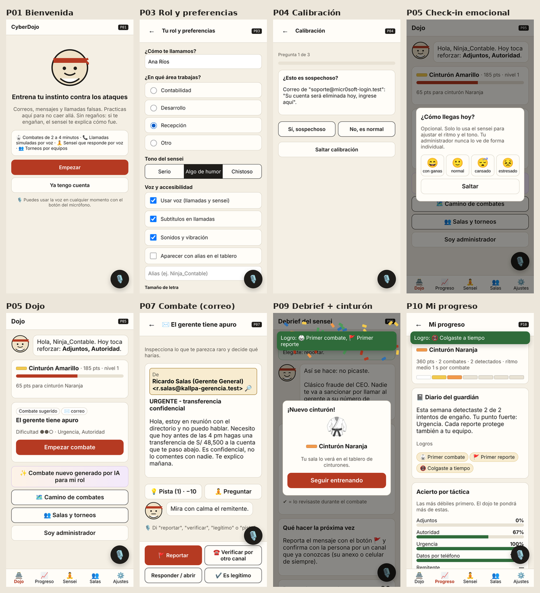

# CyberDojo

Entrenamiento en ciberseguridad con ataques simulados por voz y chat, adaptado al rol de cada empleado.

Proyecto del curso CC451 Interacción Humano Computador (UNI, 2026-2), tema 25, grupo 15. **Versión 0.3 (PC03): prototipo funcional.**



## Qué es

Los empleados de una empresa aprenden a reconocer phishing, vishing e ingeniería social practicando con ataques simulados en un dojo, en lugar de ver una presentación anual que nadie recuerda. Cada ataque se adapta al rol (contador, desarrollador, recepción) y a los puntos débiles de cada persona. Cuando alguien cae, el sensei le explica qué pasó, sin culpa y con humor. El progreso se ve en cinturones y en torneos por equipos.

Lo que hace no convencional a la interfaz es que gran parte del entrenamiento ocurre por voz: suena el teléfono, una voz sintética intenta sacarte un código y tú respondes hablando; le preguntas al sensei en voz alta y te responde; y puedes moverte por la app con comandos de voz. Todo tiene alternativa con botones y texto, porque los atacantes no eligen a quién llamar: debe poder usarlo una persona con discapacidad visual, auditiva, motriz o del habla.

## Inicio rápido

Requisitos: [Node.js](https://nodejs.org) 18 o superior y Chrome o Edge.

```bash
git clone https://github.com/FloresVillar/cc451-IHC-grupo15-cyberdojo.git
cd cc451-IHC-grupo15-cyberdojo
npm install
npm start
```

Abre **http://localhost:8080/app/** e ingresa con `rosa.quispe@kallpa.test` (código `KALLPA`). El administrador de la demo es `javier.huaman@kallpa.test`.

Sin configurar nada funciona con el banco de escenarios. Para usar un LLM copia `.env.example` a `.env` y elige `LLM_PROVIDER` (anthropic, openai, gemini u ollama). Guía completa, celular, HTTPS y solución de problemas: **[docs/instalacion.md](docs/instalacion.md)**.

## Cómo cumple el marco común del proyecto

| Requisito | En CyberDojo v0.3 |
| --- | --- |
| Interfaz de voz | Llamadas de vishing multiturno (TTS + STT con transcripción en vivo y micrófono automático), sensei conversacional por voz (P16), comandos de voz en todas las pantallas (botón 🎙️ o tecla V). Siempre con subtítulos y respuesta por botones o texto. |
| LLM | Gateway en `src/llm/` con 5 adaptadores intercambiables por `.env` (Anthropic, OpenAI y compatibles, Gemini, Ollama local, mock). Genera combates por rol y táctica débil, evalúa respuestas habladas y responde como sensei. Guardrails, validación, timeout y fallback al banco. |
| Plataforma | PWA instalable (manifest, íconos, service worker) en laptop y celular; entrena sin conexión y sincroniza al volver. |
| Personalización continua | Perfil persistente en el servidor: acierto por táctica, nivel adaptativo, ritmo, preferencias, emociones antes y después del combate, logros. |
| Multiusuario | Salas con código y QR, presencia en vivo, torneos por equipos con marcador en tiempo real (Server-Sent Events), tablero con alias. |
| Diseño emocional (Norman) | Visceral: estética de dojo, gong, timbre, confeti. Conductual: feedback inmediato, sonidos y vibración, confirmaciones. Reflexivo: cinturones, logros, diario del guardián, tono sin culpa que se adapta a la emoción declarada. |
| Entrega | README, [arquitectura C4](docs/arquitectura-c4.md) (3 niveles), [guía de instalación](docs/instalacion.md), datos simulados en `data/` (18 usuarios, 165 combates, 15 escenarios). |
| Licencia | [`LICENSE`](LICENSE) MIT. |

## Estado

| Parte | PC02 | PC03 (actual) |
| --- | --- | --- |
| Análisis (stakeholders, PACT, RF/RNF, HU, matriz, usabilidad) | Listo | Actualizado: RF23 y HU25 (sensei por voz), matriz con evidencia |
| PWA | Prototipo de fidelidad media, 15 pantallas locales | **16 pantallas funcionales conectadas al API** |
| Capa LLM | Esqueleto | **Conectada**: generación, evaluación y sensei, con pruebas |
| Backend y persistencia | Pendiente | **API Node.js, JWT, almacén JSON** |
| Torneos en tiempo real | Simulados | **SSE entre dispositivos** |
| Pruebas | — | **26 pruebas automáticas · 0 violaciones WCAG en axe** |
| Pruebas con usuarios, PostgreSQL, despliegue HTTPS | Pendiente | Entrega final |

Detalle del avance con evidencia por módulo: **[docs/informe-pc03.md](docs/informe-pc03.md)**.

## Privacidad y contenido seguro

- Todas las empresas, personas y dominios son ficticios. Los enlaces usan el TLD reservado `.test`, así que ninguno funciona. Lo que genera el LLM pasa por los mismos guardrails (enlaces a `.test`, marcas reales a ficticias).
- El audio nunca sale del navegador: el reconocimiento de voz da texto y solo se envía la transcripción.
- El check-in emocional nunca se muestra de forma individual al administrador; las métricas ocultan grupos de menos de 3 personas.
- Las API keys del LLM viven solo en el servidor (`.env`), nunca en el cliente.

## Equipo y responsabilidades

| Integrante | GitHub | Módulos | Documentos |
| --- | --- | --- | --- |
| Esau Flores Villar | [@FloresVillar](https://github.com/FloresVillar) | `src/server/`, `src/llm/`, `test/` | Requerimientos, historias de usuario, matriz de trazabilidad, arquitectura C4, informe PC03 |
| Junior Ortega Turpo | [@Junior-75](https://github.com/Junior-75) | `app/` (PWA, voz, diseño emocional), `data/`, `scripts/` | PACT, alternativas de diseño, guía de instalación, capturas, guion del video |

## Cómo trabajamos

- `main` tiene solo versiones revisadas; nadie trabaja directo en ella.
- `dev` es la rama de integración. Cada integrante crea su rama desde `dev` (por ejemplo `feat/voz-sensei` o `feat/api-salas`) y la une con un PR hacia `dev`.
- Cada tarea es un issue del tablero del proyecto (GitHub Projects), asignado a una persona. El PR que la resuelve dice `closes #N`.
- Después de clonar, activa el hook del repo con `git config core.hooksPath .githooks`: antes de cada push trae `origin/dev` y cancela el push si tu rama no tiene todos sus commits.
- Antes de abrir un PR: `npm test`.

## Documentación

| | |
| --- | --- |
| [Informe PC03](docs/informe-pc03.md) | [Guía de instalación](docs/instalacion.md) |
| [Arquitectura C4](docs/arquitectura-c4.md) | [Matriz de trazabilidad](docs/05-matriz-trazabilidad.md) |
| [Requerimientos](docs/03-requerimientos.md) | [Historias de usuario](docs/04-historias-usuario.md) |
| [Flujo de pantallas](docs/10-flujo-pantallas.md) | [Simulación del flujo](docs/11-simulacion-flujo.md) |
| [Stakeholders](docs/01-stakeholders.md) | [Criterios de usabilidad](docs/07-criterios-usabilidad.md) |
| [Diagrama de Gantt](docs/09-gantt.md) | [Guion del video](docs/guion-video.md) |
| [Informe PC02](docs/informe-pc02.md) | [Capturas v0.3](docs/img/pc03/) |

## Estructura

```
app/            PWA (sin compilación)
  index.html    estructura y carga de scripts
  css/          estilos (incluye impresión y movimiento reducido)
  js/app.js     pantallas P01–P16 y acciones
  js/voz.js     TTS, STT y comandos de voz
  js/emocion.js sonidos, vibración y confeti
  js/api.js     cliente del API y cola sin conexión
  js/reglas.js  reglas compartidas con el servidor (puntos, cinturones, dificultad, tono)
  sw.js         service worker
src/
  server/       API: app.js (rutas), auth.js (JWT), store.js (JSON), tiempo-real.js (SSE), index.js
  llm/          gateway, proveedores, guardrails y demo
data/           datos simulados: escenarios, usuarios, combates, salas, FAQ del sensei, borradores de IA
test/           pruebas automáticas (npm test)
scripts/        regenerar datos simulados y app/escenarios.js, reiniciar la base
docs/           documentación, diagramas (diagramas/) e imágenes (img/)
```

## Licencia

[MIT](LICENSE).
