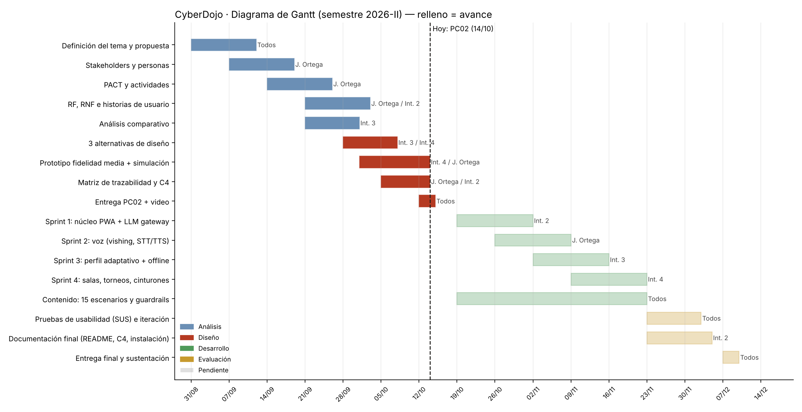

# Diagrama de Gantt

Al 14 de octubre terminamos la fase de análisis y diseño (PC02). Desde la semana siguiente trabajamos en sprints de dos semanas: primero el núcleo PWA con la capa LLM, luego voz, personalización y multiusuario. Las pruebas de usabilidad con usuarios reales van al final de noviembre para tener tiempo de iterar antes de la entrega final.

El diagrama se genera con [`diagramas/gantt.py`](diagramas/gantt.py).
