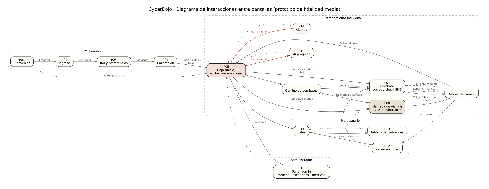

# Diagrama de flujo de pantallas

El prototipo está en `cyberdojo/app/index.html`. Es una PWA navegable (abre en el navegador, se puede instalar) que simula el flujo completo con los 15 escenarios del banco. La llamada de vishing usa la Web Speech API del navegador: habla el atacante y, si el navegador lo permite, escucha la respuesta; si no, se responde con botones o texto.

**Pantallas:**

| ID | Pantalla | Propósito |
| :--- | :--- | :--- |
| P01 | Bienvenida | Presenta al sensei y el concepto del dojo. |
| P02 | Ingreso | Correo o código de organización. |
| P03 | Rol y preferencias | Rol, nivel de humor, voz, subtítulos, alias, tamaño de letra. |
| P04 | Calibración | 3 preguntas rápidas para el nivel inicial. |
| P05 | Dojo (inicio) | Check-in emocional, cinturón, combate sugerido, accesos. |
| P06 | Camino de combates | Lista de escenarios por rol y estado. |
| P07 | Combate (correo/chat/SMS) | Mensaje inspeccionable, pistas y acciones. |
| P08 | Llamada de vishing | Llamada entrante, voz, subtítulos y respuestas. |
| P09 | Debrief del sensei | Resultado, señales, acción recomendada, puntos. |
| P10 | Mi progreso | Cinturón, tácticas débiles, historial. |
| P11 | Salas | Unirse/crear sala, miembros, próximo torneo. |
| P12 | Torneo en curso | Combates del torneo y marcador de equipos. |
| P13 | Tablero de cinturones | Ranking por equipos / individual con alias. |
| P14 | Ajustes | Preferencias y accesibilidad. |
| P15 | Panel administrador | Crear torneo, revisar escenarios, métricas. |

## Diagrama de interacciones entre pantallas

