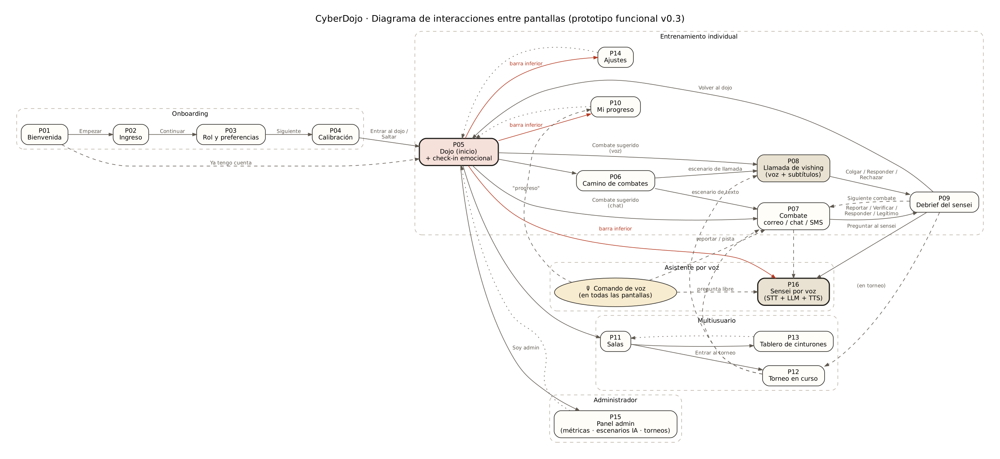

# Diagrama de flujo de pantallas

La PWA está en `app/` (v0.3, PC03). Se sirve con `npm start` y se conecta al API del servidor; también funciona sin conexión con el banco local. La llamada de vishing y el sensei usan la Web Speech API del navegador: hablan y, si el navegador lo permite, escuchan la respuesta con transcripción en vivo; si no, se responde con botones o texto. Desde cualquier pantalla (menos la llamada) el botón 🎙️ acepta comandos de voz.

**Pantallas:**

| ID | Pantalla | Propósito |
| :--- | :--- | :--- |
| P01 | Bienvenida | Presenta al sensei y el concepto del dojo. |
| P02 | Ingreso | Correo o código de organización. |
| P03 | Rol y preferencias | Rol, nivel de humor, voz, subtítulos, alias, tamaño de letra. |
| P04 | Calibración | 3 preguntas rápidas para el nivel inicial. |
| P05 | Dojo (inicio) | Check-in emocional, cinturón, combate sugerido, accesos. |
| P06 | Camino de combates | Lista de escenarios por rol y estado. |
| P07 | Combate (correo/chat/SMS) | Mensaje inspeccionable, pistas y acciones. |
| P08 | Llamada de vishing | Llamada entrante, voz, subtítulos y respuestas. |
| P09 | Debrief del sensei | Resultado, señales, acción recomendada, puntos. |
| P10 | Mi progreso | Cinturón, tácticas débiles, historial. |
| P11 | Salas | Unirse/crear sala, miembros, próximo torneo. |
| P12 | Torneo en curso | Combates del torneo y marcador de equipos. |
| P13 | Tablero de cinturones | Ranking por equipos / individual con alias. |
| P14 | Ajustes | Preferencias y accesibilidad. |
| P15 | Panel administrador | Métricas, revisión de escenarios de IA, creación de torneos. |
| P16 | Sensei por voz *(PC03)* | Conversación por voz con el asistente (STT + LLM + TTS). |

## Diagrama de interacciones entre pantallas

Capturas de cada pantalla funcionando: [`img/pc03/`](img/pc03/).
