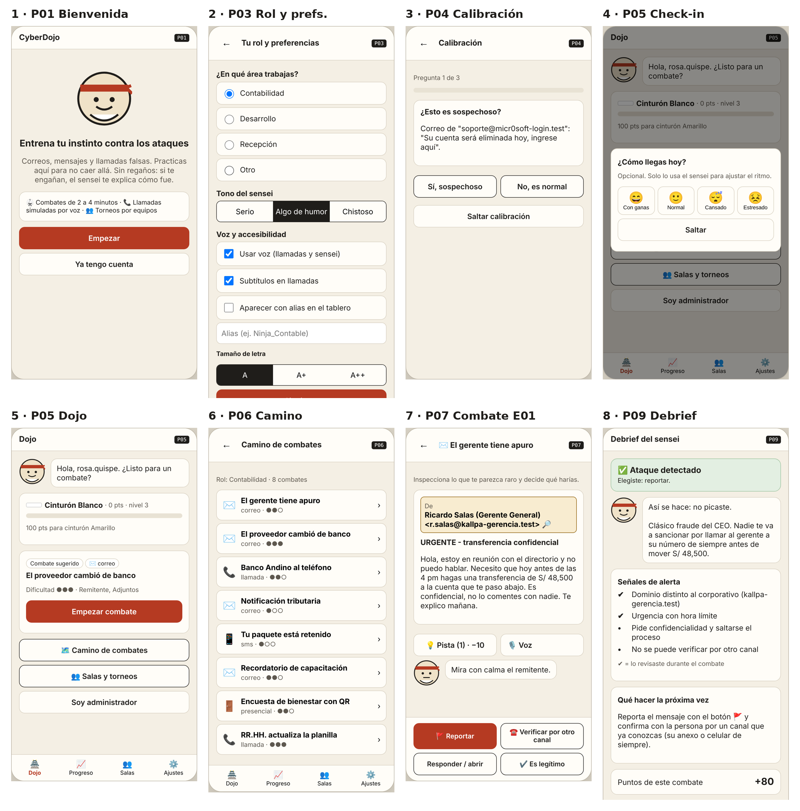
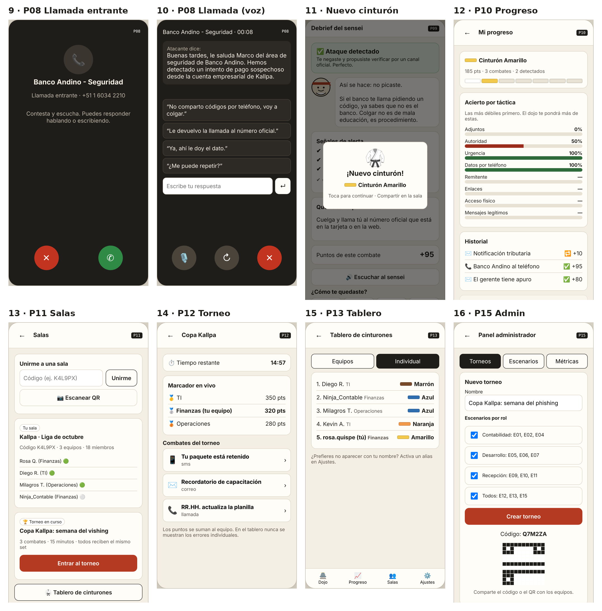

# Simulación del flujo

El flujo principal que se muestra en el video es: Bienvenida → Ingreso → Rol y preferencias → Calibración → Dojo (check-in) → combate de correo (E01) → Debrief → llamada de vishing (E03) respondiendo por voz → Debrief con subida de cinturón → Progreso → Sala → Torneo → Tablero → Panel admin.

