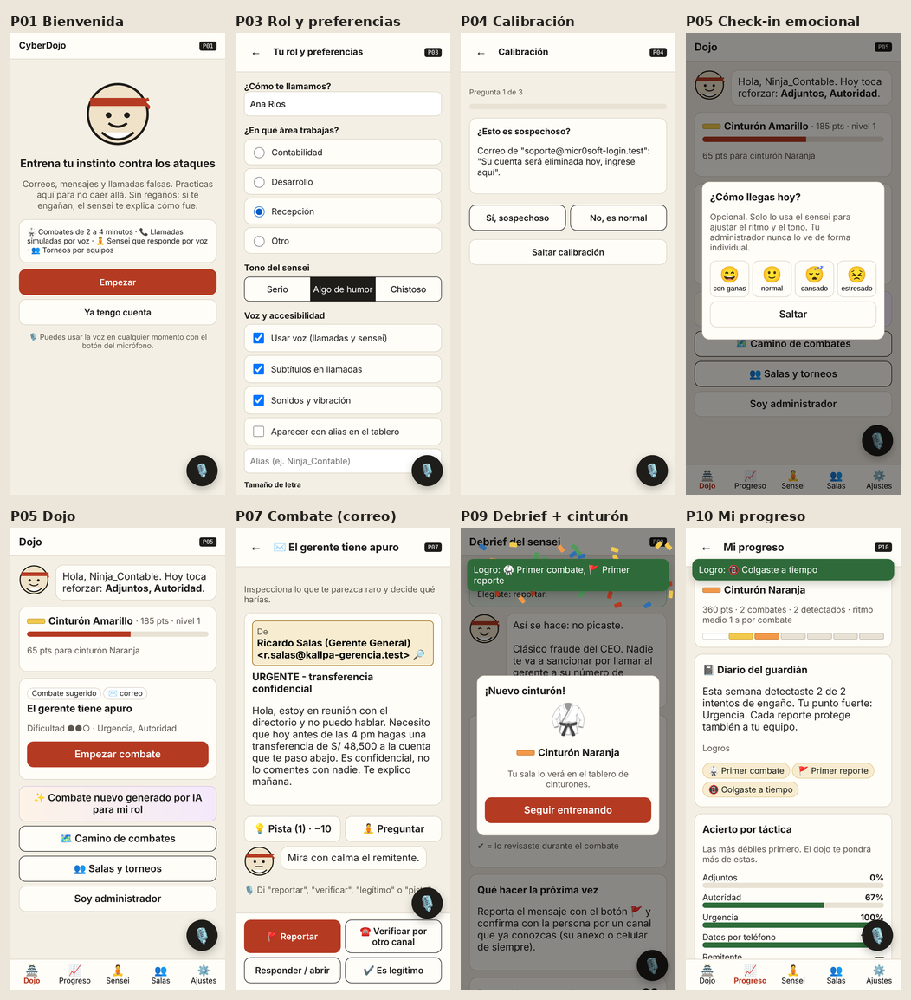
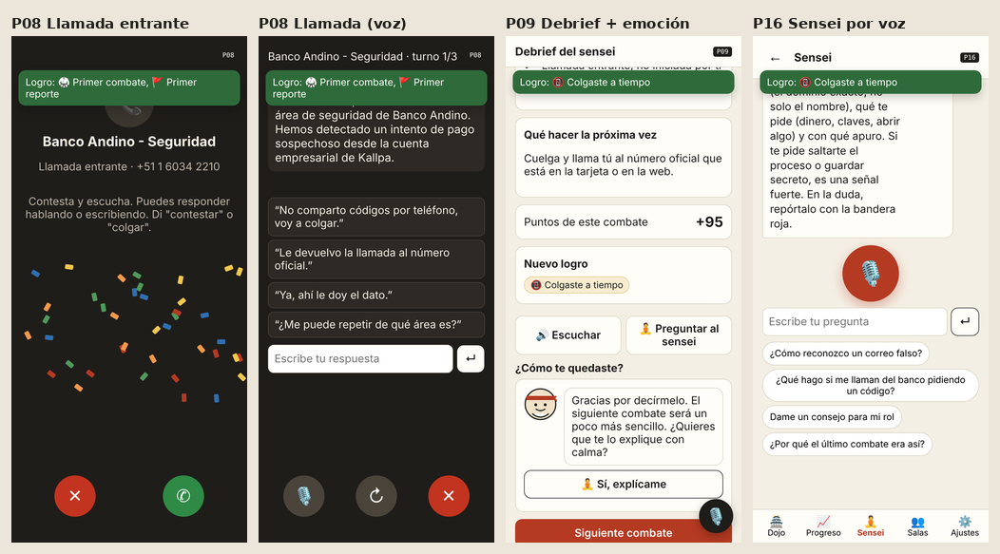
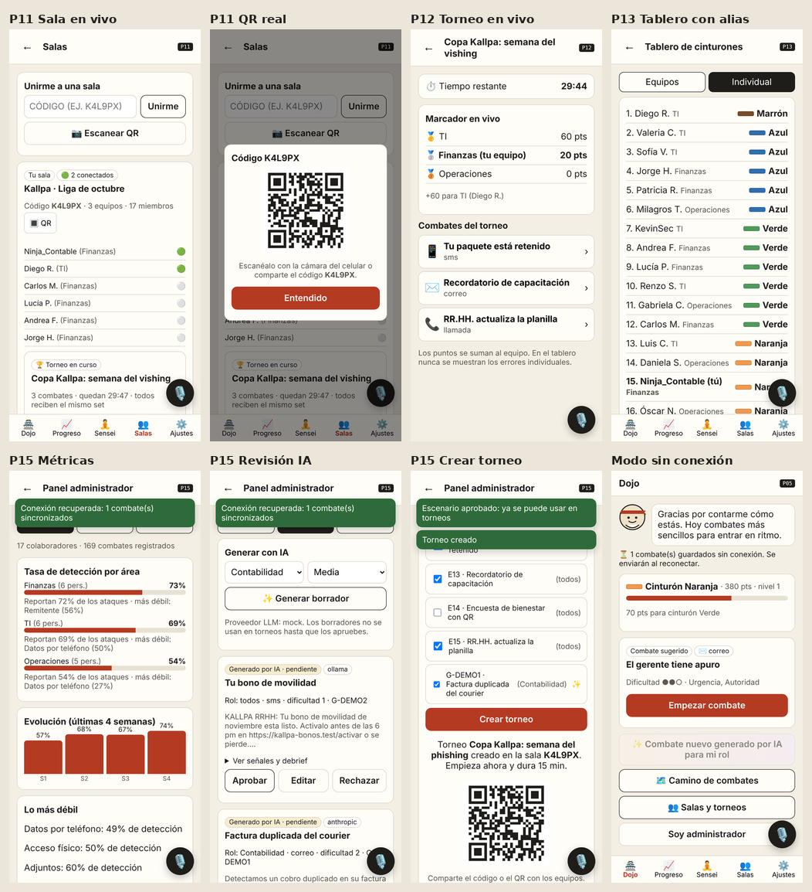
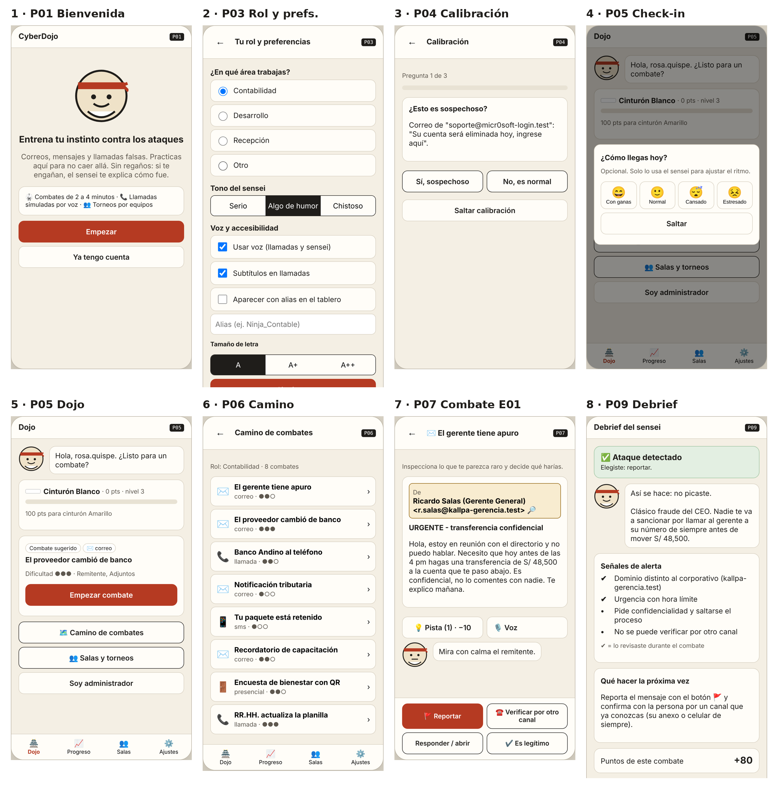
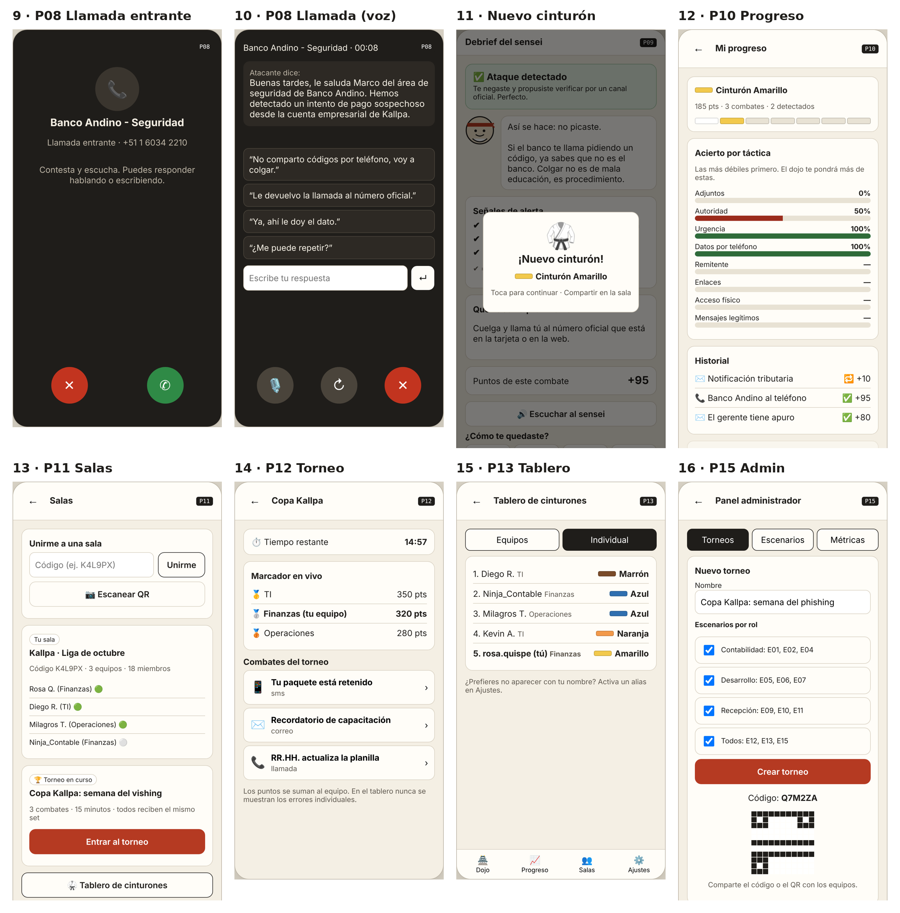

# Simulación del flujo

## PC03 (prototipo funcional v0.3)

Flujo que se muestra en el video: Bienvenida → Ingreso (Rosa) → check-in emocional → Dojo → combate de correo E01 reportado por voz → Debrief con subida de cinturón → llamada de vishing E03 respondida hablando → Debrief y emoción posterior → Sensei por voz → Progreso → modo sin conexión → Salas con 2 dispositivos conectados → QR → Torneo con marcador en vivo → Tablero → Panel admin (métricas, aprobación de escenarios de IA, torneo con QR).

Todas las capturas individuales están en [`img/pc03/`](img/pc03/). Se generaron con una prueba automática de punta a punta en Chrome.

## PC02 (prototipo de fidelidad media)

