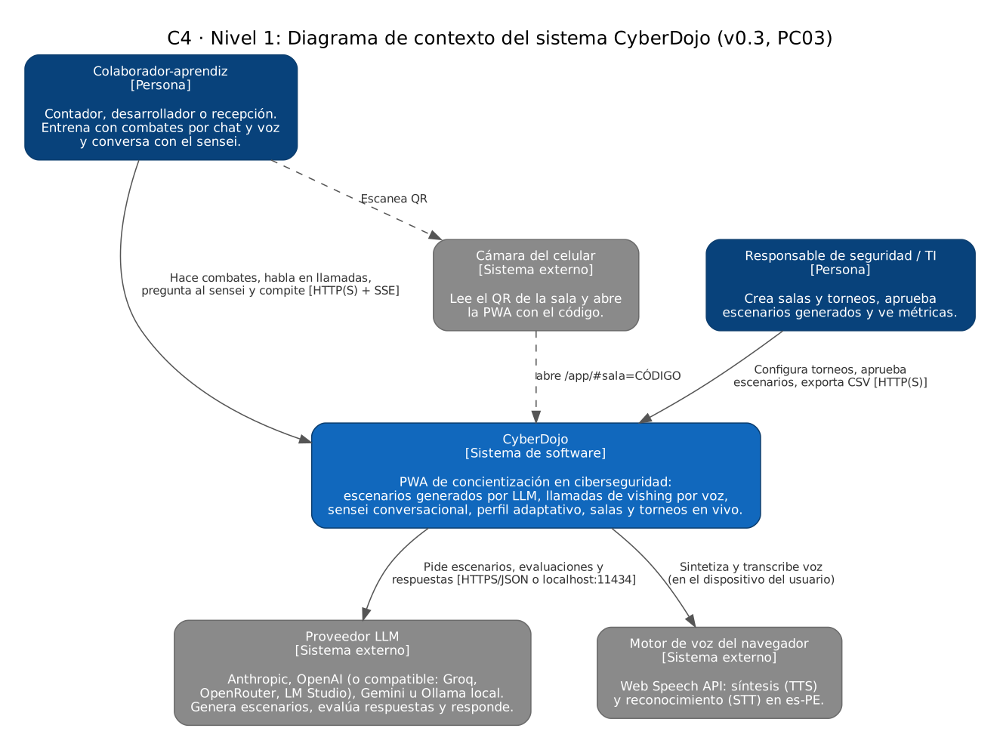
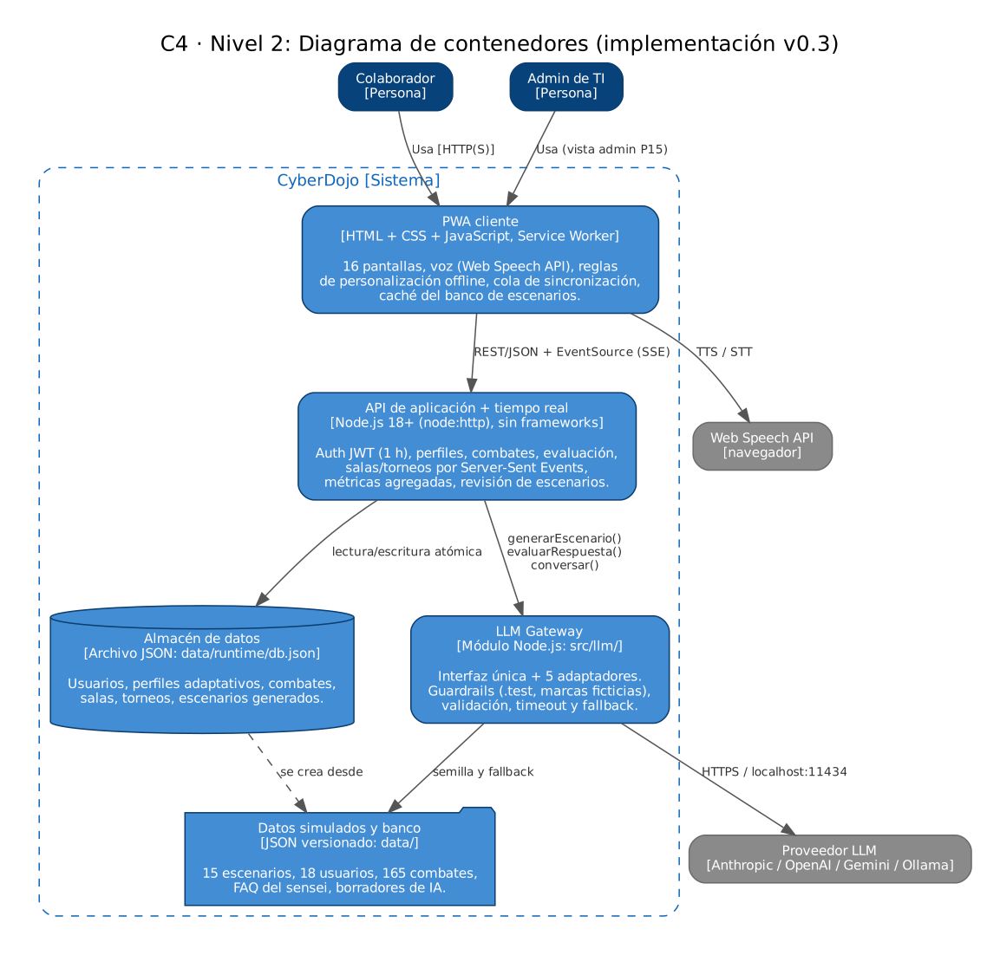
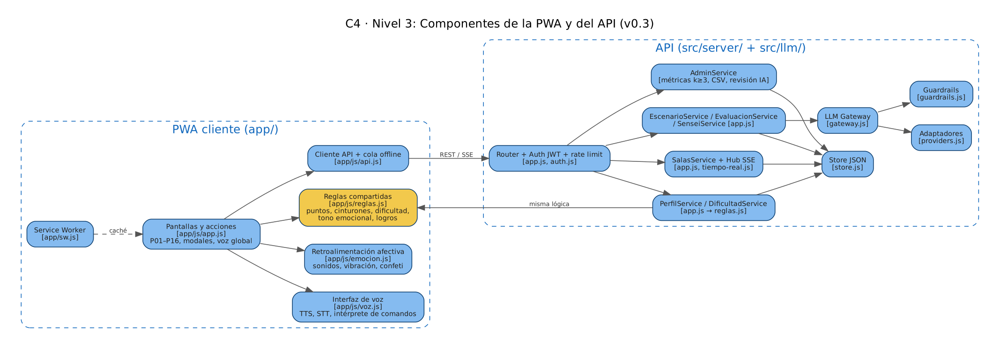

# Arquitectura (modelo C4) · versión implementada v0.3

Este documento describe la arquitectura **tal como está implementada** en la PC03. Al final se explica qué cambió respecto al diseño de la PC02 y por qué.

## Nivel 1 · Contexto

CyberDojo lo usan dos tipos de persona: el **colaborador** (entrena) y el **responsable de TI** (organiza y supervisa). Depende de:

- **Proveedor de LLM**: genera escenarios, evalúa respuestas habladas y responde como sensei. Puede ser una API remota (Anthropic, OpenAI o compatible, Gemini) o un modelo local con Ollama.
- **Motor de voz del navegador** (Web Speech API): síntesis y reconocimiento de voz en el propio dispositivo.
- **Cámara del celular**: lee el QR de una sala, que abre la PWA con el código de la sala.

## Nivel 2 · Contenedores

| Contenedor | Tecnología | Responsabilidad |
|---|---|---|
| PWA cliente | HTML + CSS + JavaScript sin frameworks, Service Worker, Web Speech API | 16 pantallas, voz, reglas de personalización sin conexión, cola de sincronización, caché del banco. |
| API de aplicación + tiempo real | Node.js 18+ (`node:http`), Server-Sent Events | Autenticación JWT, perfiles, combates, evaluación, salas y torneos en vivo, métricas, revisión de escenarios. Sirve también los archivos de la PWA. |
| LLM Gateway | Módulo Node.js (`src/llm/`) | Interfaz única `generarEscenario()`, `evaluarRespuesta()`, `conversar()`; adaptadores; guardrails; validación; timeout y fallback. |
| Almacén de datos | Archivo JSON (`data/runtime/db.json`) con escritura atómica | Usuarios, perfiles adaptativos, combates, salas, torneos, escenarios generados. |
| Datos simulados y banco | JSON versionado (`data/`) | 15 escenarios, 18 usuarios ficticios, 165 combates de 4 semanas, FAQ del sensei, borradores de IA. |

## Nivel 3 · Componentes

**PWA (`app/`)**

- `js/app.js` · pantallas P01–P16, estado, acciones, modales accesibles y comandos de voz globales.
- `js/voz.js` · TTS, STT con transcripción en vivo e intérprete de comandos ("reportar", "pista", "progreso"…). Lo que no es comando se envía como pregunta al sensei.
- `js/emocion.js` · retroalimentación afectiva: gong al acertar, sonido suave al caer, timbre de llamada, vibración, confeti; respeta `prefers-reduced-motion`.
- `js/api.js` · cliente REST/SSE, renovación de sesión y cola sin conexión.
- `js/reglas.js` · **reglas compartidas con el servidor**: puntos, cinturones, dificultad adaptativa, tono emocional, logros, evaluación por reglas.
- `sw.js` · caché de la app y del banco de escenarios.

**API (`src/server/`, `src/llm/`)**

- Router + `auth.js` · JWT HS256 de 1 h, rate limiting por IP y por usuario para el LLM, cabeceras de seguridad.
- PerfilService / DificultadService · aplica cada combate con `reglas.js` (el servidor recalcula los puntos; no confía en el cliente).
- EscenarioService / EvaluacionService / SenseiService · usan el gateway; guardan los escenarios generados para revisión.
- SalasService + `tiempo-real.js` · salas, unión por código/QR, torneos, marcador y presencia por SSE.
- AdminService · métricas agregadas con k-anonimato (grupos < 3 personas ocultos), clima emocional solo agregado (≥ 5 check-ins), CSV, aprobación de escenarios.
- `gateway.js`, `providers.js`, `guardrails.js` · capa LLM.
- `store.js` · persistencia JSON.

## API REST

| Método y ruta | Uso |
|---|---|
| `GET /api/salud` | Estado, proveedor LLM y latencias p50/p90. |
| `POST /api/auth/login` | Ingreso con correo y código de organización. Devuelve JWT. |
| `GET/PATCH /api/perfil` · `POST /api/perfil/emocion` | Perfil, preferencias y check-in emocional. |
| `POST /api/combates` · `POST /api/combates/lote` | Registrar combate; sincronizar los hechos sin conexión (sin duplicados). |
| `GET /api/escenarios` · `GET /api/escenarios/siguiente[?ia=1]` | Banco aprobado; siguiente combate (por reglas o generado por LLM). |
| `POST /api/evaluar` · `POST /api/sensei` | Evaluar respuesta hablada; conversar con el sensei. |
| `GET/POST /api/salas` · `GET /api/salas/:c` · `POST /api/salas/:c/unirse` | Salas. |
| `GET /api/salas/:c/eventos` | Eventos en vivo (SSE): `sala`, `marcador`. |
| `GET /api/salas/:c/tablero` · `GET /api/salas/:c/qr.svg` · `POST /api/salas/:c/torneos` | Tablero, QR y torneos. |
| `GET /api/admin/metricas[.csv]` · `GET /api/admin/escenarios` · `POST /api/admin/escenarios/generar` · `PUT /api/admin/escenarios/:id` | Panel administrador. |

## Decisiones

1. **Gateway propio en el servidor.** Las API keys nunca llegan al navegador y el proveedor se cambia con `LLM_PROVIDER` (RF04, RNF06, RNF08).
2. **Voz en el navegador.** La Web Speech API no tiene costo, responde rápido en Chrome/Edge y el audio no sale del dispositivo (RNF05). Si no hay reconocimiento de voz, todo funciona con botones y texto.
3. **Banco como semilla y fallback.** El LLM adapta una plantilla revisada. Si tarda más de `LLM_TIMEOUT_MS` o devuelve algo inválido, se usa la plantilla (RNF10).
4. **Guardrails de salida.** Enlaces y correos a `.test`, marcas reales a marcas ficticias, validación del esquema y bloqueo de instrucciones peligrosas (RNF07). Solo los escenarios aprobados entran a torneos (RF18).
5. **Reglas compartidas cliente/servidor.** `app/js/reglas.js` es un script que funciona en el navegador y en Node: la experiencia sin conexión calcula igual que el servidor.

## Cambios respecto al diseño de la PC02

| PC02 (diseño) | PC03 (implementado) | Motivo |
|---|---|---|
| React + Vite | HTML/CSS/JS sin frameworks | Sin paso de compilación: corre con doble clic o con `npm start` en cualquier laptop; menos de 150 KB. |
| Express + Socket.IO | `node:http` + Server-Sent Events | El marcador solo necesita servidor → cliente; SSE reconecta solo y no requiere librerías. |
| PostgreSQL | Archivo JSON con escritura atómica | Instalación de un paso para la demo. `store.js` aísla el acceso: migrar a PostgreSQL no toca el resto del código. Queda para la entrega final. |
| Servicio de correo para invitaciones | Código de 6 caracteres + QR real | Evita depender de SMTP; el QR abre la app y une a la sala. |
