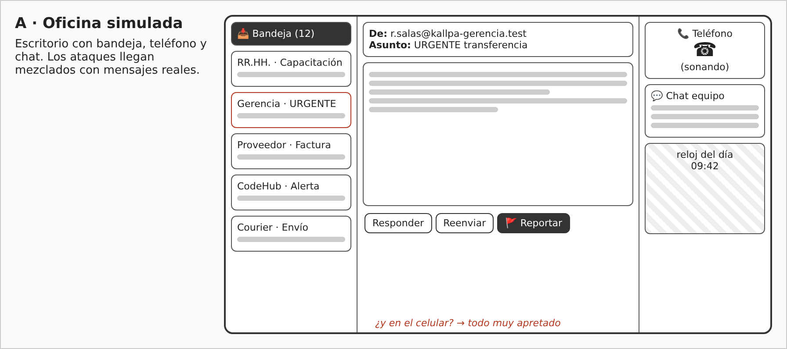
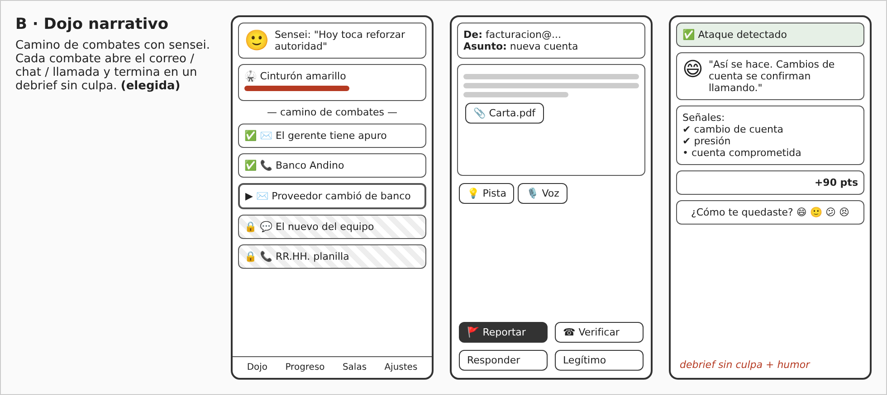
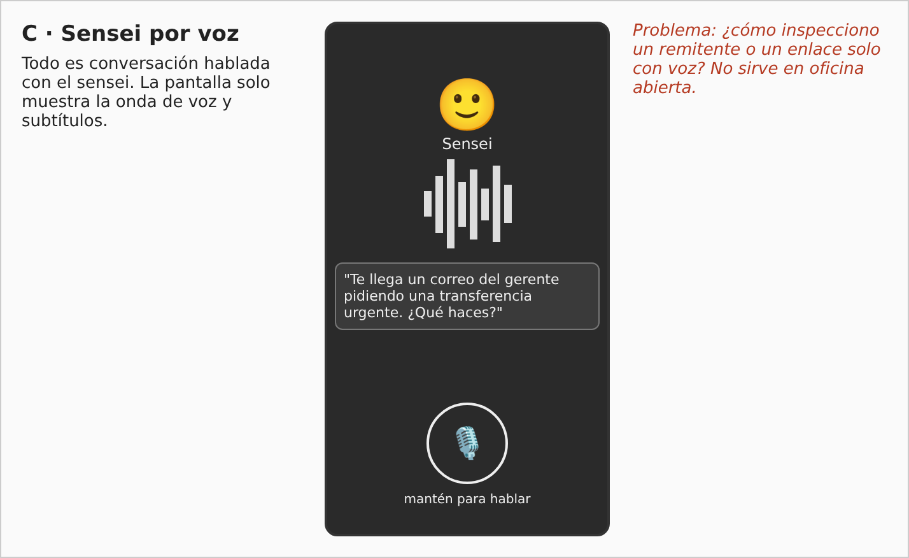
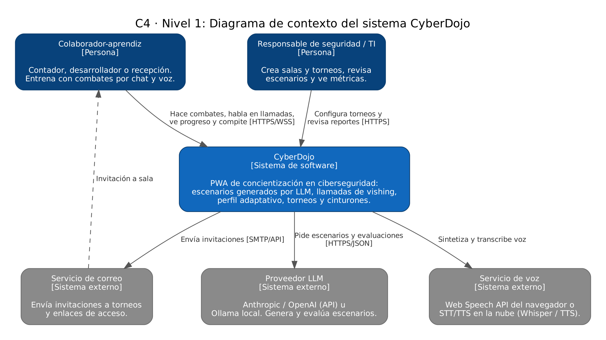
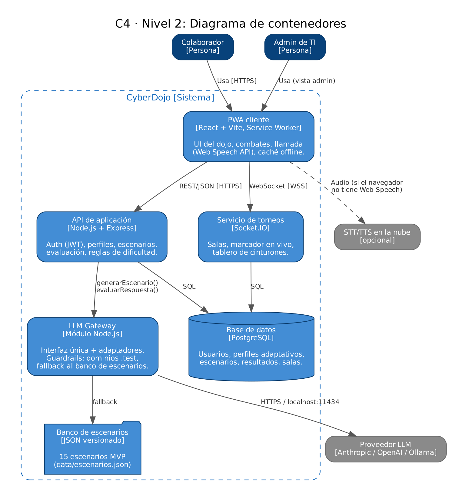

# CyberDojo: concientización en ciberseguridad

### Informe de avance – Práctica Calificada 02

CC451 Interacción Humano Computador · Tema 25 · Octubre 2026

Integrantes: Junior Ortega · [Integrante 2] · [Integrante 3] · [Integrante 4]

Repositorio: https://github.com/[usuario]/cyberdojo (licencia MIT)

## 1. Contexto del proyecto

Casi todos hemos pasado por una capacitación de seguridad informática: un video de 40 minutos, un PDF con reglas y un cuestionario al final que se responde por descarte. Al mes nadie se acuerda de nada, y el correo falso que llega el viernes a las 5 pm sigue funcionando. El problema no es que la gente no sepa que existe el phishing, es que nunca practicó reconocerlo bajo presión.

CyberDojo propone cambiar la capacitación por entrenamiento. El usuario entra a un dojo donde un sensei (el asistente) le pone "combates": correos, mensajes y llamadas falsas que tiene que detectar. Los escenarios los genera un LLM según el rol de la persona (no es lo mismo un contador que recibe facturas que un desarrollador que instala dependencias), la dificultad sube o baja según los errores que comete, y el equipo compite en torneos por cinturones. Si alguien cae, el sensei no lo regaña: le explica qué pasó, con humor y sin culpa.

Lo que hace "no convencional" a la interfaz es que gran parte del entrenamiento ocurre por voz. Las llamadas de vishing se simulan de verdad: suena el teléfono, una voz sintética intenta sacarte un código y tú respondes hablando.

**Alcance del MVP:** 15 escenarios (3 roles + escenarios generales, 4 de ellos por voz), evaluación de progreso, perfil adaptativo, salas y torneos por equipos, y panel básico para el administrador. Todo como PWA que corre en laptop y en celular.

**Cómo cumplimos los requerimientos comunes del curso:**

| Requerimiento común | Cómo lo resuelve CyberDojo |
| :--- | :--- |
| Interfaces de voz | Llamadas de vishing con TTS + STT, comandos de voz para navegar y sensei que narra el debrief. |
| LLM con capa de abstracción | Módulo `llm-gateway` con interfaz única `generarEscenario()` / `evaluarRespuesta()`; proveedores intercambiables por `.env` (API remota o Ollama local). |
| PWA | Manifest + service worker; instalable y con escenarios en caché para jugar sin conexión. |
| Personalización continua | Perfil con aciertos/errores por táctica, ritmo, preferencias de humor y check-in emocional. La dificultad se recalcula después de cada combate. |
| Multiusuario | Salas por código/QR, torneos por equipos y tablero de cinturones. |
| Diseño emocional (Norman) | Visceral: estética de dojo y sensei. Conductual: feedback inmediato y micro-interacciones. Reflexivo: cinturones e identidad de "guardián" del equipo. |
| Entrega en GitHub | README, diagrama C4, guía de instalación y datos simulados en `/data`. |
| Licencia | Archivo `LICENSE` MIT en la raíz del repositorio. |

## 2. Análisis de usuarios (stakeholders)

Nos quedamos solo con los actores sin los cuales el sistema no funciona. Partimos de cómo trabaja cada rol en una pyme típica y de nuestra propia experiencia con capacitaciones obligatorias en prácticas preprofesionales. Las personas de abajo son arquetipos que construimos con esa información.

| Stakeholder | Tipo | Qué necesita | Qué aporta / por qué es indispensable |
| :--- | :--- | :--- | :--- |
| Colaborador-aprendiz (contador, desarrollador, recepción) | Usuario primario | Practicar en poco tiempo, sin sentirse juzgado, con casos que se parezcan a su trabajo real. | Es quien usa la app a diario; sus errores alimentan el perfil adaptativo. |
| Responsable de seguridad / TI de la organización | Usuario secundario (administrador) | Crear salas y torneos, ver si el equipo mejora, revisar los escenarios antes de publicarlos. | Sin él no hay salas, ni torneos, ni validación del contenido que genera el LLM. |
| Proveedor del LLM y de voz (API remota o modelo local) | Stakeholder técnico externo | API key, límites de uso, políticas de contenido. | Genera escenarios y evalúa respuestas. Sus políticas condicionan qué ataques se pueden simular (por eso la capa de abstracción y el banco de respaldo). |

### 2.1 Personas

**Rosa, 47 años – Contadora (rol contador).** Lleva 20 años en la empresa, maneja transferencias y pagos a proveedores. Usa la computadora todo el día pero desconfía de las "apps de juegos". Le preocupa equivocarse delante de su jefe. Usa lentes y prefiere letras grandes. Le sirve que la app le hable de facturas, cambios de cuenta y llamadas del banco.

**Diego, 26 años – Desarrollador backend (rol desarrollador).** Siente que ya sabe todo sobre phishing y que la capacitación es pérdida de tiempo. Se engancha con la competencia y los rankings. Su riesgo real está en dependencias falsas, tokens y pedidos de acceso por chat. Si el escenario es muy fácil, abandona.

**Milagros, 31 años – Recepcionista (rol recepción).** Atiende teléfono y visitas al mismo tiempo, siempre con interrupciones. Usa más el celular que la laptop. Su riesgo está en llamadas de "gerentes", visitas sin cita y objetos olvidados. Necesita sesiones cortas (menos de 5 minutos) que pueda pausar.

**Javier, 38 años – Jefe de TI (administrador).** Tiene que reportar a gerencia que "se capacitó al personal". Quiere métricas claras, no 30 gráficos. No tiene tiempo de escribir escenarios, pero sí de revisar los que genera el sistema.

### 2.2 Diferencias entre usuarios y cómo influyen en el diseño

| Diferencia | Ejemplo | Decisión de diseño |
| :--- | :--- | :--- |
| Rol laboral | Rosa ve facturas; Diego ve repositorios. | El rol se elige al registrarse y el LLM recibe el rol como parámetro. Cada rol tiene escenarios propios + escenarios "para todos". |
| Experiencia previa en seguridad | Diego cree que sabe; Rosa siente que no sabe nada. | Calibración inicial de 3 preguntas. La dificultad arranca en nivel distinto y se ajusta con cada combate. |
| Actitud frente al error | Rosa teme quedar mal; Diego quiere ganar. | Debrief sin culpa y privado. En el tablero público solo se ven cinturones y puntos del equipo, nunca los errores individuales. Opción de alias. |
| Tiempo y dispositivo | Milagros usa el celular entre llamadas. | Diseño mobile-first, combates de 2–4 minutos, progreso guardado si se interrumpe. |
| Entorno (ruido, oficina abierta) | Recepción tiene ruido; en open space no se puede hablar en voz alta. | Toda interacción por voz tiene alternativa en texto (subtítulos + respuesta escrita). |
| Edad y alfabetización digital | Rosa prefiere letra grande y menos íconos sueltos. | Botones con texto + ícono, tamaño de fuente ajustable, nada de gestos ocultos. |

### 2.3 Usuarios con discapacidad

| Tipo | Barrera que encontramos | Cómo lo resolvemos |
| :--- | :--- | :--- |
| Visual (baja visión o ceguera) | Inspeccionar un correo depende de "ver" el remitente o el enlace. | Elementos inspeccionables como botones reales con etiqueta accesible ("Remitente: r.salas@kallpa-gerencia.test"). Compatibilidad con lectores de pantalla (TalkBack, VoiceOver, NVDA). Contraste mínimo 4.5:1 y fuente escalable al 200%. Las llamadas de vishing son accesibles por naturaleza. |
| Auditiva | Las llamadas de vishing son solo audio. | Subtítulos en vivo de la voz del atacante y respuesta por texto. Las vibraciones/animaciones reemplazan los sonidos de feedback. |
| Motriz | Tocar elementos pequeños, arrastrar. | Objetivos táctiles de 44×44 px mínimo, navegación completa por teclado, comandos de voz ("reportar", "siguiente", "pista"), sin límites de tiempo estrictos (el temporizador del torneo se puede extender). |
| Habla | No poder responder la llamada hablando. | La respuesta escrita cuenta igual que la hablada; no penaliza. |
| Cognitiva / ansiedad | Presión del temporizador, sobrecarga de información. | Modo "práctica sin reloj", textos cortos, un solo objetivo por pantalla, check-in emocional que baja la intensidad si la persona dice que está estresada. |

## 3. Análisis PACT

### 3.1 People (personas)

Adultos de 20 a 60 años que trabajan en oficina, con alfabetización digital variada. Motivación inicial baja (la capacitación es obligatoria). Diferencias principales: rol, experiencia, actitud ante el error y discapacidades (ver sección 2). Del lado del administrador, una persona técnica con poco tiempo.

### 3.2 Activities (actividades)

| Actividad | Frecuencia / duración | Características | Requerimientos que genera |
| :--- | :--- | :--- | :--- |
| A1. Hacer un combate por chat/correo | 2–3 veces por semana, 2–4 min | Inspeccionar remitente, enlaces y adjuntos; decidir qué hacer. Tarea de juicio, no de memoria. | RF03, RF05, RF08, RF20, RNF01 |
| A2. Atender una llamada de vishing | 1 vez por semana, 1–3 min | Tiempo real, presión social, se interrumpe. Requiere voz bidireccional y alternativa textual. | RF06, RF07, RF19, RNF02, RNF03 |
| A3. Revisar el debrief y aprender | Después de cada combate, 1 min | Momento emocional delicado: puede sentirse "engañado". | RF09, RF11, RNF12 |
| A4. Ver mi progreso y cinturón | Semanal | Reflexivo, motivación a largo plazo. | RF12, RF13, RF22 |
| A5. Competir en torneo por equipos | Mensual, 15–20 min | Colaborativa y en simultáneo; el equipo discute en la sala. | RF14, RF15, RF16, RNF09 |
| A6. Configurar y supervisar (admin) | Mensual | Crear salas, asignar escenarios, revisar contenido generado, sacar reportes. | RF17, RF18, RF22 |
| A7. Configurar preferencias | Al inicio y ocasional | Voz, humor, accesibilidad, alias. | RF02, RF10, RNF02 |

### 3.3 Contexts (contextos)

- **Físico:** oficina abierta (ruido, no se puede hablar fuerte), recepción (interrupciones constantes), casa o transporte (celular). Esto obliga a tener modo texto para todo lo que es voz y a guardar el estado si se interrumpe.
- **Social:** la capacitación la "manda" la empresa; hay miedo a quedar mal frente a jefes y compañeros. Por eso los errores son privados y el ranking es por equipo.
- **Organizacional:** cada empresa tiene políticas propias (cómo reportar, a quién llamar). El admin puede ajustar la "acción correcta" de cada escenario a su procedimiento.

### 3.4 Technologies (tecnologías)

- **Entrada:** micrófono (Web Speech API / Whisper), teclado, touch.
- **Salida:** pantalla, voz sintética (Web Speech API / TTS del proveedor), vibración.
- **Comunicación:** WebSockets para torneos en tiempo real; REST para lo demás.
- **Contenido:** LLM (Claude, GPT o Llama local vía Ollama) detrás de una capa de abstracción, con banco de 15 escenarios de respaldo.
- **Plataforma:** PWA (React + Vite), backend Node.js (Express) y PostgreSQL. Debe correr en una laptop convencional y en un celular de gama media.

## 4. Requerimientos y alcance

### 4.1 Requerimientos funcionales (RF)

| ID | Requerimiento | Prioridad |
| :--- | :--- | :--- |
| RF01 | El sistema debe permitir registrarse e iniciar sesión con correo o con código de organización, eligiendo un rol (contador, desarrollador, recepción, otro). | Alta |
| RF02 | El sistema debe ofrecer un onboarding con calibración inicial (3 preguntas) y elección de preferencias: voz, nivel de humor y accesibilidad. | Alta |
| RF03 | El sistema debe generar escenarios mediante el LLM adaptados al rol y a la dificultad actual del usuario, usando las plantillas del banco de 15 escenarios. | Alta |
| RF04 | El sistema debe acceder al LLM a través de una capa de abstracción que permita cambiar de proveedor (remoto o local) solo con configuración. | Alta |
| RF05 | El sistema debe simular correos, SMS y chats con elementos inspeccionables (remitente, enlaces, adjuntos) y acciones: reportar, verificar por otro canal, responder, marcar como legítimo. | Alta |
| RF06 | El sistema debe simular llamadas de vishing por voz: voz sintética del atacante, reconocimiento de la respuesta hablada y conversación de varios turnos. | Alta |
| RF07 | El sistema debe ofrecer subtítulos en vivo y respuesta escrita en toda llamada simulada. | Alta |
| RF08 | El sistema debe evaluar la decisión del usuario y las señales de alerta que identificó, y asignar un puntaje por combate. | Alta |
| RF09 | El sistema debe mostrar un debrief inmediato del sensei con las señales de alerta, la acción recomendada y un mensaje sin culpa, en el tono de humor elegido. | Alta |
| RF10 | El sistema debe mantener un perfil persistente (aciertos y errores por táctica, tiempos de respuesta, preferencias, emoción declarada) y ajustar la dificultad después de cada combate. | Alta |
| RF11 | El sistema debe permitir un check-in emocional opcional (antes/después del combate) y adaptar el tono e intensidad según la respuesta. | Media |
| RF12 | El sistema debe otorgar puntos y cinturones (blanco a negro) según el desempeño acumulado. | Alta |
| RF13 | El sistema debe mostrar un panel de progreso con cinturón actual, puntos débiles por táctica e historial de combates. | Alta |
| RF14 | El sistema debe permitir crear y unirse a salas mediante código o QR. | Alta |
| RF15 | El sistema debe permitir torneos por equipos donde todos resuelven el mismo set de escenarios y los puntos se suman por equipo en tiempo real. | Alta |
| RF16 | El sistema debe mostrar un tablero de cinturones por equipo e individual, con opción de alias. | Media |
| RF17 | El sistema debe ofrecer un panel de administrador para crear salas/torneos, asignar escenarios por rol y ver métricas agregadas y anónimas. | Alta |
| RF18 | El sistema debe permitir al administrador revisar, editar y aprobar escenarios generados antes de usarlos en un torneo. | Media |
| RF19 | El sistema debe aceptar comandos de voz básicos: "reportar", "repetir", "pista", "siguiente", "colgar". | Media |
| RF20 | El sistema debe ofrecer hasta 2 pistas por escenario, con un pequeño costo en puntos. | Baja |
| RF21 | El sistema debe permitir jugar escenarios del banco sin conexión y sincronizar el progreso al reconectar. | Media |
| RF22 | El sistema debe permitir exportar el reporte de progreso (usuario) y el reporte del equipo (admin) en PDF o CSV. | Baja |

### 4.2 Requerimientos no funcionales (RNF)

| ID | Categoría | Requerimiento | Métrica de verificación |
| :--- | :--- | :--- | :--- |
| RNF01 | Usabilidad | La app debe ser fácil de aprender y usar sin capacitación previa. | SUS ≥ 75; primer combate completado en < 5 min sin ayuda por el 90% de los participantes. |
| RNF02 | Accesibilidad | Cumplir WCAG 2.2 nivel AA. | Contraste ≥ 4.5:1, navegación 100% por teclado, 0 errores críticos en axe/Lighthouse, prueba con lector de pantalla. |
| RNF03 | Rendimiento | Respuestas rápidas en chat y voz. | Chat: primer token < 1.5 s y respuesta completa < 3 s (p90). Voz: turno completo < 2.5 s (p90). |
| RNF04 | Plataforma (PWA) | Instalable y funcional en laptop y móvil. | Manifest válido, service worker activo, Lighthouse PWA ≥ 90; probado en Chrome, Edge y Safari iOS. |
| RNF05 | Privacidad | Datos personales mínimos; el audio no se almacena. | Solo se guardan transcripciones si el usuario lo acepta; cumplimiento de la Ley 29733 de protección de datos personales. |
| RNF06 | Seguridad | Comunicación y credenciales protegidas. | HTTPS obligatorio, JWT con expiración de 1 h, API keys solo en el backend, rate limiting por usuario. |
| RNF07 | Seguridad del contenido | El LLM no debe producir enlaces funcionales, malware ni datos reales. | Filtro de salida: 100% de enlaces reescritos a dominios `.test`; lista de bloqueo de marcas reales; revisión de 50 generaciones sin fallas. |
| RNF08 | Mantenibilidad | Cambiar de proveedor LLM sin tocar el código de negocio. | Cambio de proveedor solo editando `.env`; pruebas unitarias del gateway con 2 proveedores. |
| RNF09 | Escalabilidad | Soportar torneos simultáneos. | 50 usuarios concurrentes por sala con latencia de actualización del tablero < 1 s. |
| RNF10 | Disponibilidad | Si el LLM falla, la experiencia no se corta. | Fallback automático al banco de escenarios en < 3 s ante timeout o error. |
| RNF11 | Lenguaje | Español claro y cercano (Perú). | Textos revisados con prueba de lectura; sin tecnicismos sin explicar. |
| RNF12 | Diseño emocional | Ningún mensaje culpabiliza al usuario. | Checklist de tono aplicado al 100% de los debriefs; 0 mensajes con palabras como "fallaste" o "error grave". |
| RNF13 | Entrega / licencia | Repositorio abierto y documentado. | README, C4, guía de instalación, datos simulados y LICENSE MIT presentes. |
| RNF14 | Compatibilidad | Corre en equipos comunes. | Laptop con 4 GB RAM y celular Android/iOS de gama media sin degradación notable. |

### 4.3 Historias de usuario

**HU01 – Registro con rol.** Como colaborador, quiero registrarme y elegir mi rol, para recibir ataques parecidos a los de mi trabajo.
- Dado que estoy en la pantalla de ingreso, cuando ingreso mi correo o un código de organización válido, entonces se crea mi cuenta.
- Dado que me registré, cuando elijo un rol, entonces queda guardado en mi perfil y puedo cambiarlo luego en Ajustes.
- Si el código de organización no existe, se muestra un mensaje claro y sugerencia para pedirlo a TI.

**HU02 – Calibración inicial.** Como colaborador nuevo, quiero responder unas preguntas rápidas al inicio, para no empezar con algo muy fácil ni muy difícil.
- Se muestran exactamente 3 preguntas tipo "¿Esto es sospechoso?" con una sola pantalla por pregunta.
- Al terminar, se asigna un nivel inicial (1, 2 o 3) visible en el perfil.
- Se puede saltar la calibración; en ese caso se empieza en nivel 1.

**HU03 – Escenario según mi rol.** Como contadora, quiero que los ataques hablen de facturas y transferencias, para practicar con situaciones que sí me pueden pasar.
- El escenario generado incluye el rol y la dificultad del usuario en el prompt (se puede verificar en el log del gateway).
- Al menos el 70% de los escenarios que recibe un usuario corresponden a su rol; el resto son "para todos".
- Si el LLM no responde en 3 s, se carga un escenario equivalente del banco.

**HU04 – Inspeccionar un mensaje.** Como colaborador, quiero tocar el remitente, los enlaces y los adjuntos, para ver los detalles antes de decidir.
- Al tocar el remitente se muestra el correo completo y el dominio resaltado.
- Al tocar un enlace no se navega: se muestra la URL real en un globo de vista previa.
- Cada elemento inspeccionado se registra como "señal revisada" para la evaluación.

**HU05 – Tomar una decisión.** Como colaborador, quiero elegir qué hacer con el mensaje (reportar, verificar, responder, marcar como legítimo), para practicar el procedimiento correcto.
- Las 4 acciones están visibles como botones con texto e ícono.
- Al elegir una acción, se pide confirmación solo si es "responder" o "abrir adjunto".
- Tras la decisión se pasa al debrief en menos de 1 s.

**HU06 – Llamada de vishing por voz.** Como colaborador, quiero recibir una llamada simulada y responder hablando, para entrenar cómo reacciono bajo presión.
- La pantalla de llamada entrante muestra "Contestar" y "Rechazar"; rechazar también se evalúa.
- La voz del atacante se reproduce y, al terminar, se activa el micrófono con un indicador visible.
- La respuesta transcrita se evalúa; si contiene una acción segura (colgar, verificar, no compartir), el combate termina con éxito.
- La llamada tiene máximo 3 turnos del atacante.

**HU07 – Llamada sin audio.** Como usuario con discapacidad auditiva (o en una oficina ruidosa), quiero ver subtítulos y responder escribiendo, para hacer los combates de voz sin desventaja.
- Los subtítulos aparecen sincronizados con la voz y se pueden activar por defecto desde Ajustes.
- Existe un campo de texto y respuestas rápidas en cada turno de la llamada.
- La puntuación no cambia por responder en texto.

**HU08 – Debrief sin culpa.** Como colaborador que cayó en un ataque, quiero una explicación clara y sin regaños, para aprender sin sentirme mal.
- El debrief muestra: resultado, señales de alerta (marcando las que sí detecté), acción recomendada y una frase del sensei.
- Ningún texto usa palabras de culpa (validado con el checklist de tono).
- El debrief se puede escuchar en voz alta con un botón.

**HU09 – Nivel de humor.** Como colaborador, quiero elegir si el sensei es serio o bromista, para que el tono me resulte cómodo.
- En Ajustes hay 3 niveles: "Serio", "Con algo de humor", "Modo chistoso".
- El nivel elegido se envía al LLM y cambia el texto del debrief.

**HU10 – Dificultad adaptativa.** Como colaborador, quiero que la app me ponga más casos de lo que más fallo, para mejorar donde realmente lo necesito.
- Tras cada combate se actualiza el porcentaje de acierto por táctica.
- Si una táctica tiene acierto < 60%, el siguiente escenario sugerido la incluye.
- Con 3 aciertos seguidos sube la dificultad; con 2 errores seguidos baja.

**HU11 – Check-in emocional.** Como colaborador, quiero decir cómo me siento antes de empezar, para que la app no me presione en un mal día.
- Se muestra una fila de 4 emojis opcionales al iniciar sesión (máximo una vez al día).
- Si elijo "estresado", se sugiere modo práctica sin reloj y el sensei usa un tono más suave.
- La respuesta se guarda en el perfil y no es visible para el administrador de forma individual.

**HU12 – Ganar cinturones.** Como colaborador, quiero subir de cinturón, para sentir que avanzo.
- Los cinturones son: blanco, amarillo, naranja, verde, azul, marrón y negro, con umbrales de puntos definidos.
- Al subir de cinturón se muestra una animación corta (< 2 s) y se puede compartir en la sala.

**HU13 – Ver mi progreso.** Como colaborador, quiero ver mis puntos débiles, para saber en qué enfocarme.
- El panel muestra cinturón actual, puntos para el siguiente, gráfico por táctica e historial de los últimos 10 combates.
- Las tácticas débiles aparecen primero y con una sugerencia de combate.

**HU14 – Unirme a una sala.** Como colaborador, quiero unirme a la sala de mi equipo con un código, para entrenar con mis compañeros.
- Puedo ingresar un código de 6 caracteres o escanear un QR.
- Al unirme, veo los miembros conectados y el próximo torneo programado.

**HU15 – Torneo por equipos.** Como colaborador, quiero competir con mi equipo contra otras áreas, para hacerlo más entretenido.
- Todos los participantes reciben el mismo set de escenarios.
- El puntaje del equipo se actualiza en tiempo real (< 1 s) en todos los dispositivos.
- Al final se muestra el podio de equipos, no el ranking de errores individuales.

**HU16 – Tablero con alias.** Como colaborador, quiero aparecer con un alias en el tablero, para participar sin exponerme.
- Puedo activar un alias en Ajustes; en el tablero solo aparece el alias.
- El tablero se puede ver por equipos o individual.

**HU17 – Crear torneo (admin).** Como responsable de TI, quiero crear una sala y un torneo con escenarios por rol, para organizar la capacitación del mes.
- Puedo definir nombre, fecha, duración, equipos y escenarios.
- Al guardar, se genera un código de sala y un QR para compartir.

**HU18 – Revisar escenarios generados (admin).** Como responsable de TI, quiero revisar los escenarios que genera la IA antes de publicarlos, para que se ajusten a nuestros procedimientos.
- Veo cada escenario con su texto, señales y acción correcta, y puedo editarlos.
- Solo los escenarios aprobados se pueden usar en torneos.

**HU19 – Métricas del equipo (admin).** Como responsable de TI, quiero ver métricas agregadas, para reportar a gerencia si el equipo mejora.
- El panel muestra tasa de detección, tasa de reporte y táctica más débil por área.
- No se muestran resultados individuales con nombre si el usuario usa alias.
- Puedo exportar el reporte a PDF o CSV.

**HU20 – Navegar por voz.** Como usuario con movilidad reducida, quiero dar comandos de voz, para usar la app sin tocar la pantalla.
- Los comandos "reportar", "repetir", "pista", "siguiente" y "colgar" funcionan en las pantallas de combate.
- Se muestra en pantalla el comando reconocido como confirmación.

**HU21 – Pedir pista.** Como colaborador indeciso, quiero pedir una pista, para no quedarme trabado.
- Hay máximo 2 pistas por escenario; cada una descuenta 10 puntos.
- La pista orienta ("mira el dominio") pero no da la respuesta.

**HU22 – Jugar sin conexión.** Como recepcionista que usa el celular en el metro, quiero hacer combates sin internet, para aprovechar el tiempo.
- Los 15 escenarios del banco se guardan en caché tras la primera sesión.
- El progreso offline se sincroniza al reconectar sin duplicar puntos.

**HU23 – Cambiar proveedor de LLM (técnica).** Como equipo de desarrollo, queremos cambiar de proveedor de LLM con una variable de entorno, para no depender de uno solo.
- `LLM_PROVIDER=anthropic|openai|ollama` cambia el proveedor sin modificar el código de negocio.
- Las pruebas del gateway pasan con al menos 2 proveedores.

**HU24 – Exportar mi progreso.** Como colaborador, quiero descargar mi progreso, para tener constancia de mi capacitación.
- Puedo exportar un PDF con cinturón, combates realizados y fecha.

## 5. Matriz de trazabilidad

Estados: **Prototipo** = implementado en el prototipo de fidelidad media; **Diseñado** = definido en diseño, se implementa en el sprint indicado; **Pendiente** = planificado para sprint posterior. Las pantallas se identifican como P01–P15 (ver sección 9).

| ID Req | Descripción del Requerimiento | Tipo (FR/NFR) | Prioridad | Historia(s) de Usuario que lo cubre(n) | ID HU | Estado | Criterio de Aceptación | Evidencia/Observación |
| :--- | :--- | :--- | :--- | :--- | :--- | :--- | :--- | :--- |
| RF01 | Registro/ingreso con rol | FR | Alta | Registro con rol | HU01 | Prototipo | Cuenta creada con correo o código válido; rol guardado y editable. | P02, P03. Validación de código simulada. |
| RF02 | Onboarding con calibración y preferencias | FR | Alta | Calibración inicial | HU02 | Prototipo | 3 preguntas; nivel inicial asignado; opción de saltar. | P01, P03. |
| RF03 | Generación de escenarios por LLM según rol y dificultad | FR | Alta | Escenario según mi rol | HU03 | Diseñado (Sprint 1) | ≥ 70% escenarios del rol; fallback si > 3 s. | En prototipo se usan los 15 escenarios de `data/escenarios.json`. |
| RF04 | Capa de abstracción de proveedor LLM | FR | Alta | Cambiar proveedor de LLM | HU23 | Diseñado (Sprint 1) | Cambio de proveedor solo por `.env`. | Interfaz en `src/llm/gateway.js` (esqueleto en repo). |
| RF05 | Simulación de correo/SMS/chat inspeccionable con acciones | FR | Alta | Inspeccionar un mensaje; Tomar una decisión | HU04, HU05 | Prototipo | Enlaces muestran URL sin navegar; 4 acciones visibles. | P07. |
| RF06 | Llamada de vishing por voz multiturno | FR | Alta | Llamada de vishing por voz | HU06 | Prototipo | TTS + micrófono; máximo 3 turnos; respuesta evaluada. | P08 con Web Speech API (Chrome). |
| RF07 | Subtítulos y respuesta escrita en llamadas | FR | Alta | Llamada sin audio | HU07 | Prototipo | Subtítulos sincronizados; respuestas rápidas y campo de texto. | P08. |
| RF08 | Evaluación de decisión y señales | FR | Alta | Tomar una decisión; Llamada de vishing | HU05, HU06 | Prototipo | Puntaje por acción correcta + señales revisadas. | Lógica simple en prototipo; en producción la evalúa el LLM. |
| RF09 | Debrief sin culpa del sensei | FR | Alta | Debrief sin culpa; Nivel de humor | HU08, HU09 | Prototipo | Muestra resultado, señales, acción y frase; botón escuchar. | P09. |
| RF10 | Perfil persistente y dificultad adaptativa | FR | Alta | Calibración; Dificultad adaptativa | HU02, HU10 | Prototipo (parcial) | Acierto por táctica actualizado; sube/baja dificultad según regla. | Perfil en `localStorage` del prototipo; en producción en PostgreSQL. |
| RF11 | Check-in emocional y ajuste de tono | FR | Media | Check-in emocional | HU11 | Prototipo | 4 emojis; "estresado" activa modo sin reloj. | P05 (modal). |
| RF12 | Puntos y cinturones | FR | Alta | Ganar cinturones | HU12 | Prototipo | 7 cinturones con umbrales; animación < 2 s. | P09, P10. |
| RF13 | Panel de progreso | FR | Alta | Ver mi progreso | HU13 | Prototipo | Cinturón, puntos débiles e historial visibles. | P10. |
| RF14 | Salas por código/QR | FR | Alta | Unirme a una sala | HU14 | Prototipo | Código de 6 caracteres; lista de miembros. | P11 (miembros simulados). |
| RF15 | Torneos por equipos en tiempo real | FR | Alta | Torneo por equipos | HU15 | Prototipo (simulado) | Mismo set; puntaje actualizado < 1 s; podio por equipos. | P12; tiempo real simulado con temporizador. WebSockets en Sprint 4. |
| RF16 | Tablero de cinturones con alias | FR | Media | Tablero con alias | HU16 | Prototipo | Vista equipo/individual; alias reemplaza nombre. | P13. |
| RF17 | Panel admin: salas, torneos, métricas | FR | Alta | Crear torneo; Métricas del equipo | HU17, HU19 | Prototipo (parcial) | Torneo creado genera código y QR; métricas agregadas. | P15 con datos simulados. |
| RF18 | Revisión/aprobación de escenarios | FR | Media | Revisar escenarios generados | HU18 | Prototipo (parcial) | Solo aprobados se usan en torneo. | P15, pestaña "Escenarios". |
| RF19 | Comandos de voz | FR | Media | Navegar por voz | HU20 | Diseñado (Sprint 2) | 5 comandos reconocidos con confirmación visual. | Botón de micrófono en P07/P08 como maqueta. |
| RF20 | Pistas con costo | FR | Baja | Pedir pista | HU21 | Prototipo | Máx. 2 pistas, −10 pts c/u. | P07. |
| RF21 | Modo offline con sincronización | FR | Media | Jugar sin conexión | HU22 | Diseñado (Sprint 3) | 15 escenarios en caché; sin puntos duplicados. | `sw.js` cachea el shell del prototipo. |
| RF22 | Exportar reportes PDF/CSV | FR | Baja | Métricas del equipo; Exportar mi progreso | HU19, HU24 | Pendiente (Sprint 4) | PDF/CSV descargable con datos correctos. | Botón visible en P10 y P15 (no funcional). |
| RNF01 | Usabilidad: SUS ≥ 75, primer combate < 5 min | NFR | Alta | Calibración; Inspeccionar; Debrief | HU02, HU04, HU08 | Pendiente (pruebas) | SUS ≥ 75 con 5–8 usuarios; 90% completa sin ayuda. | Plan de pruebas en sección 7; prueba piloto programada para la semana del 23/11. |
| RNF02 | Accesibilidad WCAG 2.2 AA | NFR | Alta | Llamada sin audio; Navegar por voz | HU07, HU20 | Prototipo (parcial) | Contraste ≥ 4.5:1; teclado; lector de pantalla. | Prototipo con roles ARIA y foco visible; falta auditoría con axe. |
| RNF03 | Latencia chat < 3 s, voz < 2.5 s (p90) | NFR | Alta | Escenario según rol; Llamada de vishing | HU03, HU06 | Pendiente (Sprint 2) | Medición p90 en 50 interacciones. | Se medirá con logs del gateway. |
| RNF04 | PWA instalable, Lighthouse ≥ 90 | NFR | Alta | Jugar sin conexión | HU22 | Prototipo (parcial) | Manifest + SW; instalable en Chrome y Safari. | `manifest.webmanifest` y `sw.js` en `/app`. |
| RNF05 | Privacidad y Ley 29733 | NFR | Alta | Check-in emocional; Tablero con alias | HU11, HU16 | Diseñado | Audio no almacenado; emoción no visible al admin. | Política en README. |
| RNF06 | HTTPS, JWT, API keys en backend | NFR | Alta | Registro con rol; Cambiar proveedor | HU01, HU23 | Diseñado (Sprint 1) | Sin API keys en el cliente; JWT 1 h. | Ver diagrama C4 (contenedores). |
| RNF07 | Contenido seguro del LLM | NFR | Alta | Escenario según rol; Revisar escenarios | HU03, HU18 | Diseñado (Sprint 1) | 100% enlaces reescritos a `.test`. | Datos simulados ya usan `.test`. |
| RNF08 | Mantenibilidad: proveedor por `.env` | NFR | Alta | Cambiar proveedor de LLM | HU23 | Diseñado (Sprint 1) | Pruebas con 2 proveedores. | `src/llm/`. |
| RNF09 | 50 usuarios concurrentes por sala | NFR | Media | Torneo por equipos | HU15 | Pendiente (Sprint 4) | Prueba de carga con k6. | — |
| RNF10 | Fallback al banco si falla el LLM | NFR | Alta | Escenario según rol | HU03 | Diseñado (Sprint 1) | Fallback < 3 s. | El prototipo ya funciona solo con el banco. |
| RNF11 | Español claro (Perú) | NFR | Media | Debrief sin culpa | HU08 | Prototipo | Revisión de textos. | Textos de los 15 escenarios. |
| RNF12 | Tono sin culpa | NFR | Alta | Debrief sin culpa; Nivel de humor | HU08, HU09 | Prototipo | Checklist de tono al 100% de debriefs. | Debriefs en `escenarios.json`. |
| RNF13 | Repo con README, C4, instalación, datos, LICENSE | NFR | Alta | Cambiar proveedor de LLM | HU23 | Prototipo | Archivos presentes en la raíz. | Carpeta `cyberdojo/`. |
| RNF14 | Compatibilidad laptop 4 GB y móvil gama media | NFR | Media | Jugar sin conexión; Unirme a sala | HU22, HU14 | Prototipo (parcial) | Sin degradación notable. | Prototipo sin dependencias pesadas; probado en Chrome de escritorio, falta probar en Android/iOS. |

## 6. Análisis comparativo

Revisamos plataformas de concientización y dos referencias de gamificación. Lo que buscábamos era entender qué hacen bien y qué hueco deja cada una.

| Sistema | Qué hace | Lo bueno | Lo que le falta (y tomamos como oportunidad) |
| :--- | :--- | :--- | :--- |
| KnowBe4 | Plataforma corporativa con biblioteca de cursos y campañas de phishing simulado enviadas al correo real. | Muy completa; reportes para gerencia; simulaciones en el entorno real. | Cursos largos tipo video; enfoque en "atrapar" al empleado, que genera rechazo. Los escenarios no se generan por rol en tiempo real. |
| Hoxhunt | Simulaciones de phishing en el correo con dificultad adaptativa y gamificación (estrellas, rankings). | La adaptación por desempeño y el feedback inmediato funcionan muy bien. | Centrado en correo; la voz/vishing no es su núcleo. No hay narrativa ni personaje. |
| Google Phishing Quiz (Jigsaw) | Quiz web gratuito con correos falsos y explicación de cada uno. | Simple, rápido, buena explicación visual de las señales. | No hay perfil, ni progreso, ni roles, ni multiusuario; se hace una vez y ya. |
| Proofpoint Security Awareness | Plataforma corporativa con módulos cortos y simulaciones (correo, SMS, USB). | Variedad de canales y contenido corto. | Experiencia más "de cumplimiento" que de juego; poca personalización del tono. |
| Duolingo (referencia de gamificación) | Aprendizaje de idiomas con rachas, ligas y una mascota con personalidad. | Sesiones cortas, ligas por semana, tono con humor. | No es de seguridad, pero de aquí tomamos la mascota con humor y las ligas. |

**Conclusiones para CyberDojo:**

- Las plataformas corporativas resuelven bien la medición pero la experiencia es de cumplimiento. Nuestro diferencial es la **narrativa del dojo** y el **tono sin culpa**.
- La **llamada de vishing por voz interactiva**, contestando en tiempo real a una voz que insiste, es lo que menos encontramos en las opciones revisadas y es el centro de nuestra GUI no convencional.
- La **generación de escenarios por rol con LLM** nos permite no depender de una biblioteca fija.
- De Hoxhunt y Duolingo tomamos la adaptación por desempeño, las sesiones cortas y la competencia por grupos.

## 7. Criterios de usabilidad

Usamos los objetivos de usabilidad de Preece/Rogers y las 10 heurísticas de Nielsen, pero bajados a cosas que podamos medir en CyberDojo.

| Criterio | Qué significa en CyberDojo | Métrica / meta | Cómo lo medimos |
| :--- | :--- | :--- | :--- |
| Facilidad de aprendizaje | Entender el dojo y hacer el primer combate sin tutorial largo. | Primer combate completado en < 5 min por el 90% de usuarios. | Prueba con 5–8 usuarios, cronómetro. |
| Eficiencia | Llegar a un combate desde el inicio rápido. | Máximo 2 toques desde el Dojo hasta un combate. | Análisis del flujo (diagrama de interacciones). |
| Eficacia | Que el entrenamiento mejore la detección. | +25% de tasa de detección entre la semana 1 y la semana 4. | Comparar resultados del perfil. |
| Prevención de errores | No penalizar acciones por accidente. | Confirmación en acciones riesgosas ("responder", "abrir adjunto"); deshacer disponible 5 s. | Revisión heurística. |
| Visibilidad del estado | Saber siempre en qué combate estoy, cuánto falta y si el micrófono escucha. | Indicador de micrófono y progreso en el 100% de pantallas de combate. | Revisión heurística + observación. |
| Satisfacción | Que la experiencia sea agradable. | SUS ≥ 75 y ≥ 4/5 en "me gustaría seguir usándola". | Cuestionario SUS + pregunta adicional. |
| Accesibilidad | Usable con lector de pantalla, teclado y sin audio. | WCAG 2.2 AA, 0 errores críticos en axe. | Auditoría automática + prueba con lector de pantalla. |
| Recuperación emocional | No abandonar después de fallar. | ≥ 80% de usuarios que fallan un combate inician otro en la misma sesión. | Métrica de la app. |
| Consistencia | Las mismas acciones en el mismo lugar en todos los combates. | Barra de acciones fija abajo en P07 y P08. | Revisión heurística. |

**Diseño emocional (Norman), aplicado:**

- **Visceral:** estética de dojo (tatami, papel, tinta), sensei con expresiones, sonido de gong al ganar. La primera impresión no debe ser "otra capacitación corporativa".
- **Conductual:** respuesta inmediata a cada acción, micro-interacciones (el enlace "tiembla" al inspeccionarlo, la tarjeta de señal se marca con un sello), vibración corta al reportar, voz natural del atacante.
- **Reflexivo:** cinturones que se pueden compartir, rol de "guardián" del equipo, mensajes del sensei que reconocen el esfuerzo ("te costó, pero lo viste a tiempo"). El aprendizaje se siente propio, no impuesto.

## 8. Alternativas de diseño

Antes de llegar al diseño final probamos tres caminos con bocetos y los discutimos en grupo usando a las personas de la sección 2 como filtro.

### Alternativa A – "Oficina simulada"

La pantalla imita un escritorio de trabajo: bandeja de entrada, teléfono y chat corporativo. Los ataques llegan mezclados con mensajes normales, como en un día real.

- **A favor:** muy realista, buena transferencia al trabajo.
- **En contra:** en el celular se ve apretado; se siente como "más trabajo"; no hay espacio para el sensei ni para la parte emocional. Para alguien como Rosa, la bandeja llena genera ansiedad.

### Alternativa B – "Dojo narrativo" (elegida)

El usuario entra a un dojo con un camino de combates. Cada combate abre un escenario (correo, chat o llamada) dentro de un marco narrativo y el sensei da el debrief al final.

- **A favor:** motivador, funciona igual en móvil y laptop, el sensei da el tono sin culpa, encaja con cinturones y torneos.
- **En contra:** riesgo de sentirse infantil; lo mitigamos con un estilo sobrio y con el nivel de humor configurable.

### Alternativa C – "Sensei por voz" (voice-first)

Todo es una conversación con el sensei por voz; la pantalla solo muestra una onda y subtítulos.

- **A favor:** la más "no convencional", manos libres, muy accesible para baja visión.
- **En contra:** no sirve para practicar correos (hay que ver el remitente y los enlaces), no se puede usar en oficina abierta, y es difícil revisar el progreso.

### Comparación y decisión

| Criterio (peso) | A. Oficina simulada | B. Dojo narrativo | C. Sensei por voz |
| :--- | :--- | :--- | :--- |
| Realismo de los ataques (20%) | 5 | 4 | 3 |
| Motivación / diseño emocional (20%) | 2 | 5 | 4 |
| Uso en móvil (15%) | 2 | 5 | 4 |
| Accesibilidad (15%) | 3 | 4 | 3 |
| Soporte a voz y vishing (15%) | 4 | 4 | 5 |
| Soporte a torneos y progreso (15%) | 2 | 5 | 2 |
| **Total ponderado (sobre 5)** | **3.05** | **4.50** | **3.50** |

Elegimos **B** y le incorporamos lo mejor de las otras dos: de A, que dentro del combate el correo se vea como un correo real (con remitente, enlaces y adjuntos inspeccionables); de C, que la llamada de vishing ocupe toda la pantalla y se pueda resolver solo con la voz.

## 9. Diseño óptimo de fidelidad media

El prototipo está en `cyberdojo/app/index.html`. Es una PWA navegable (abre en el navegador, se puede instalar) que simula el flujo completo con los 15 escenarios del banco. La llamada de vishing usa la Web Speech API del navegador: habla el atacante y, si el navegador lo permite, escucha la respuesta; si no, se responde con botones o texto.

**Pantallas:**

| ID | Pantalla | Propósito |
| :--- | :--- | :--- |
| P01 | Bienvenida | Presenta al sensei y el concepto del dojo. |
| P02 | Ingreso | Correo o código de organización. |
| P03 | Rol y preferencias | Rol, nivel de humor, voz, subtítulos, alias, tamaño de letra. |
| P04 | Calibración | 3 preguntas rápidas para el nivel inicial. |
| P05 | Dojo (inicio) | Check-in emocional, cinturón, combate sugerido, accesos. |
| P06 | Camino de combates | Lista de escenarios por rol y estado. |
| P07 | Combate (correo/chat/SMS) | Mensaje inspeccionable, pistas y acciones. |
| P08 | Llamada de vishing | Llamada entrante, voz, subtítulos y respuestas. |
| P09 | Debrief del sensei | Resultado, señales, acción recomendada, puntos. |
| P10 | Mi progreso | Cinturón, tácticas débiles, historial. |
| P11 | Salas | Unirse/crear sala, miembros, próximo torneo. |
| P12 | Torneo en curso | Combates del torneo y marcador de equipos. |
| P13 | Tablero de cinturones | Ranking por equipos / individual con alias. |
| P14 | Ajustes | Preferencias y accesibilidad. |
| P15 | Panel administrador | Crear torneo, revisar escenarios, métricas. |

### 9.1 Diagrama de interacciones entre pantallas

### 9.2 Simulación del flujo

El flujo principal que se muestra en el video es: Bienvenida → Ingreso → Rol y preferencias → Calibración → Dojo (check-in) → combate de correo (E01) → Debrief → llamada de vishing (E03) respondiendo por voz → Debrief con subida de cinturón → Progreso → Sala → Torneo → Tablero → Panel admin.

### 9.3 Arquitectura (C4)

## 10. Planificación (Diagrama de Gantt)

Al 14 de octubre terminamos la fase de análisis y diseño (PC02). Desde la semana siguiente trabajamos en sprints de dos semanas: primero el núcleo PWA con la capa LLM, luego voz, personalización y multiusuario. Las pruebas de usabilidad con usuarios reales van al final de noviembre para tener tiempo de iterar antes de la entrega final.

## 11. Repositorio

Estructura actual del repositorio (`cyberdojo/`):

- `README.md`: descripción, cómo correr el prototipo, decisiones de diseño.
- `LICENSE`: MIT.
- `docs/arquitectura-c4.md` y diagramas en `docs/img/`.
- `docs/instalacion.md`: guía de instalación.
- `data/`: escenarios, usuarios, equipos y torneo simulados.
- `app/`: prototipo PWA (index.html, manifest, service worker).
- `src/llm/`: esqueleto de la capa de abstracción del LLM.
- `src/voice/`: envoltorio de STT/TTS.

## Referencias

- Norman, D. (2004). *Emotional Design: Why We Love (or Hate) Everyday Things*. Basic Books.
- Benyon, D. (2014). *Designing Interactive Systems* (3.ª ed.). Pearson. (Marco PACT).
- Rogers, Y., Sharp, H. y Preece, J. (2023). *Interaction Design: Beyond Human-Computer Interaction* (6.ª ed.). Wiley.
- Nielsen, J. (1994). 10 Usability Heuristics for User Interface Design. Nielsen Norman Group.
- W3C (2023). Web Content Accessibility Guidelines (WCAG) 2.2.
- Brooke, J. (1996). SUS: A quick and dirty usability scale.
- Congreso de la República del Perú (2011). Ley N.º 29733, Ley de Protección de Datos Personales.
