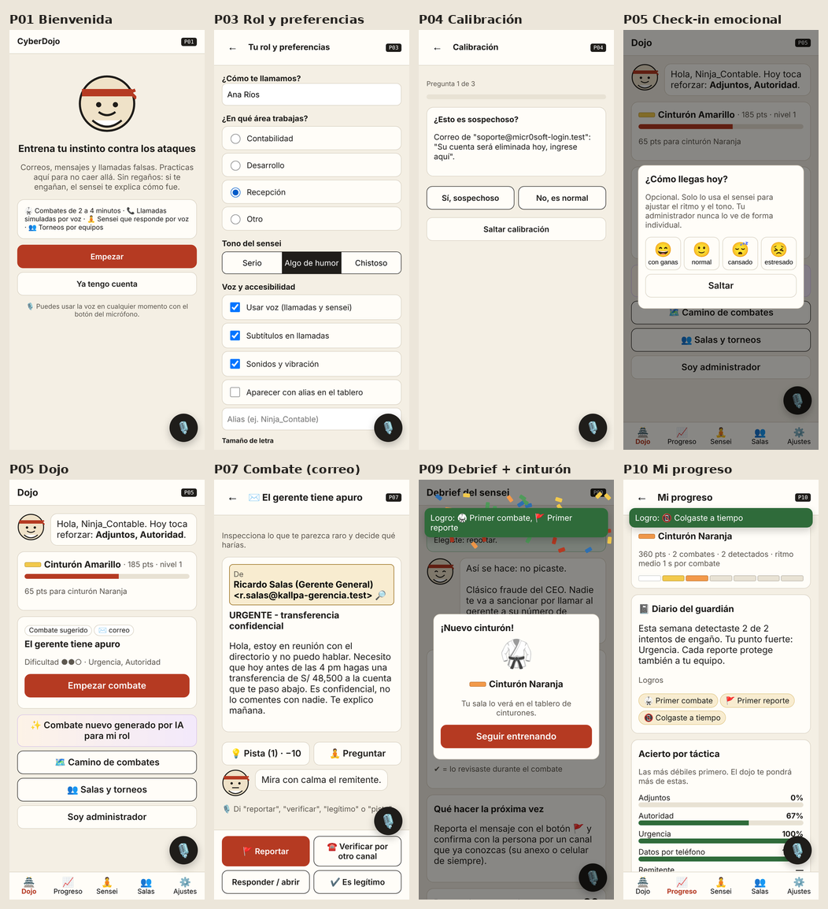
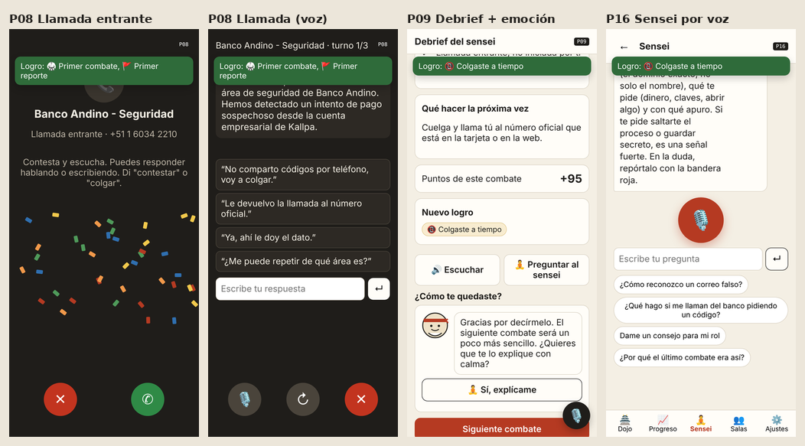
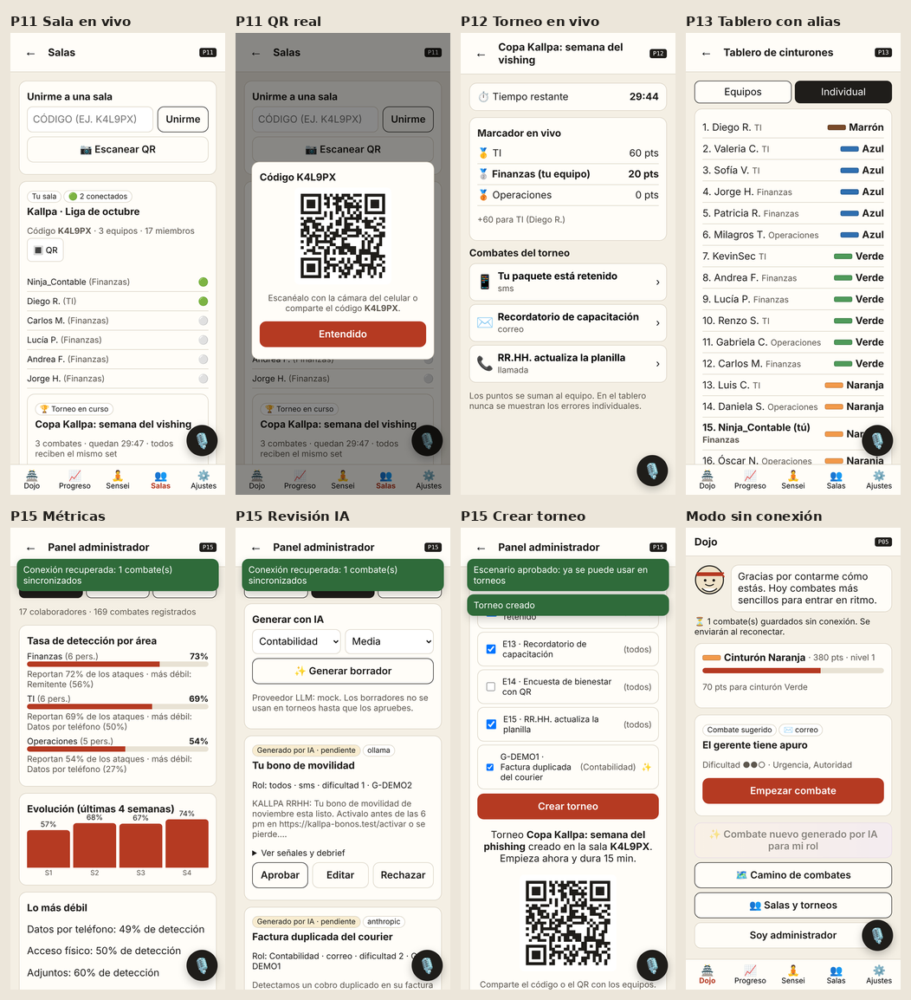
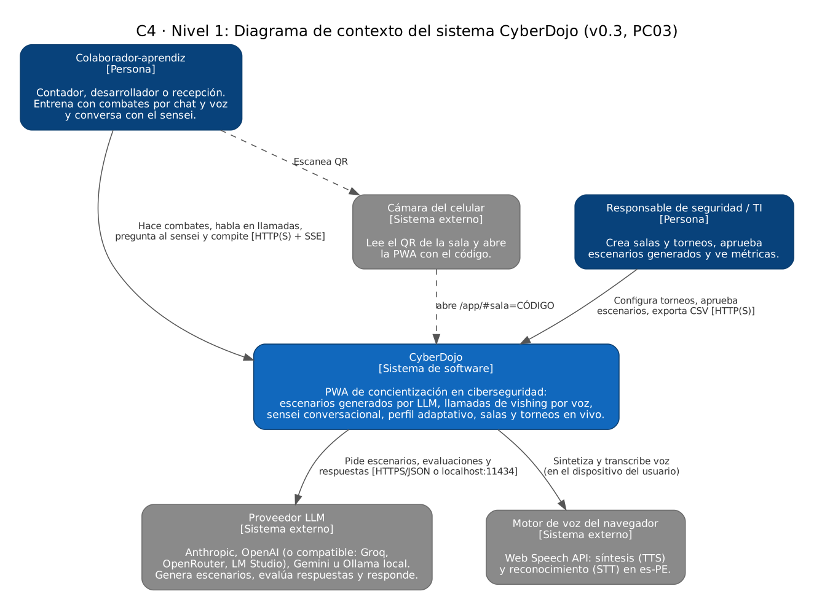
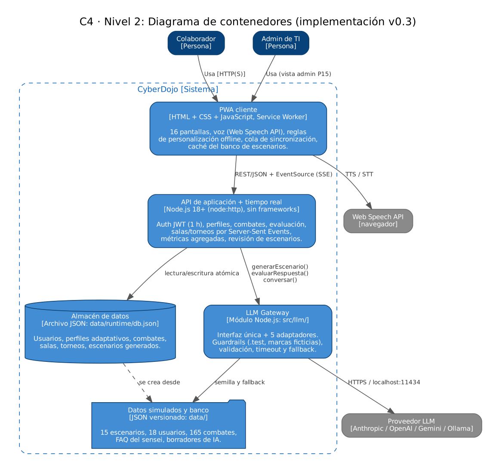
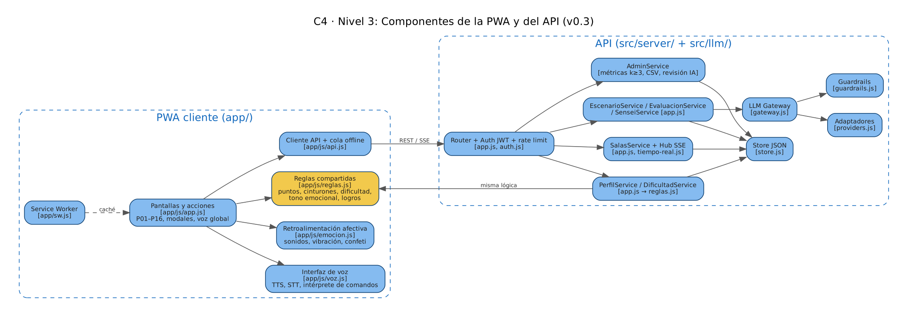

# CyberDojo: concientización en ciberseguridad

### Informe de avance – Práctica Calificada 03 (Reporte del avance del proyecto, parte 03)

CC451 Interacción Humano Computador · UNI 2026-2 · Tema 25 · Grupo 15 · 11 de noviembre de 2026

**Integrantes:** Esau Flores Villar (@FloresVillar) · Junior Ortega Turpo (@Junior-75)

**Repositorio:** <https://github.com/FloresVillar/cc451-IHC-grupo15-cyberdojo> (licencia MIT) · versión **v0.3.0**

---

## 1. Resumen del avance

En la PC02 entregamos el análisis y un prototipo de fidelidad media que funcionaba solo en el navegador, con datos fijos y el torneo simulado con un temporizador. En esta entrega el prototipo pasó a ser una **aplicación funcional cliente-servidor**:

- **Servidor Node.js** con API REST, autenticación JWT, persistencia, salas y torneos **en tiempo real** (Server-Sent Events) y panel de administrador con métricas reales y anónimas.
- **Capa LLM conectada**: genera combates adaptados al rol y a las tácticas débiles, evalúa respuestas habladas ambiguas y alimenta un **sensei conversacional por voz** (nueva pantalla P16). Cinco proveedores intercambiables por `.env` y guardrails probados.
- **Voz en toda la app**: llamadas de vishing con timbre, voz del atacante, micrófono que se activa solo al terminar cada turno y transcripción en vivo; **botón de voz global** (o tecla V) con comandos en todas las pantallas; el sensei escucha y responde en voz alta.
- **Personalización y diseño emocional**: check-in antes y después del combate que cambia el tono, la velocidad de la voz y la dificultad; ritmo por combate; logros; diario del guardián; sonidos, vibración y confeti.
- **Modo sin conexión real**: los combates se guardan en una cola y se sincronizan al reconectar sin duplicar puntos.
- **Calidad**: 26 pruebas automáticas, 0 violaciones WCAG 2.2 A/AA en la auditoría con axe-core y datos simulados de 18 usuarios y 165 combates.

### Avance respecto al producto final

| Bloque | Implementado | Parcial | Pendiente |
|---|---|---|---|
| Requerimientos funcionales (23) | 22 | 1 (RF22: PDF con el diálogo de impresión) | 0 |
| Requerimientos no funcionales (14) | 8 | 4 (RNF02, RNF03, RNF06, RNF14) | 2 (RNF01 pruebas SUS, RNF09 carga) |
| Pantallas (16) | 16 programadas y conectadas al API | — | — |

Contando cada parcial como medio punto, el avance ponderado es **(30 + 2,5) / 37 ≈ 88 %** de los requerimientos, por encima del 70 % pedido. Lo que falta es lo que necesita usuarios reales o despliegue: pruebas de usabilidad (SUS), medición de latencia con un LLM real, prueba de carga, migración a PostgreSQL y despliegue con HTTPS.

## 2. Requerimientos comunes del curso

| Requerimiento | Cómo se cumple en v0.3 | Evidencia |
|---|---|---|
| Interfaces de voz | Llamadas de vishing por voz multiturno (TTS + STT con transcripción en vivo), sensei que escucha y responde, comandos de voz globales, debrief y pistas leídos en voz alta. Siempre hay alternativa con botones y texto. | [`app/js/voz.js`](../app/js/voz.js), P08, P16 |
| LLM con capa de abstracción | `LLM_PROVIDER` = anthropic, openai (y compatibles: Groq, OpenRouter, LM Studio), gemini, ollama (local) o mock. Timeout, validación de esquema, guardrails y fallback al banco. | [`src/llm/`](../src/llm/), `npm run demo:llm`, [`test/llm.test.js`](../test/llm.test.js) |
| PWA | Manifest con íconos PNG, service worker con caché de la app y del banco, instalable, funciona sin conexión. | [`app/manifest.webmanifest`](../app/manifest.webmanifest), [`app/sw.js`](../app/sw.js) |
| Personalización continua | Perfil persistente en el servidor: acierto por táctica, nivel, ritmo, preferencias (humor, voz, subtítulos, letra, velocidad), emociones antes/después, logros. Se actualiza en cada combate. | [`app/js/reglas.js`](../app/js/reglas.js), P10 |
| Multiusuario | Salas con código y QR real, presencia en vivo, torneos con marcador en tiempo real por SSE, tablero con alias. | [`src/server/tiempo-real.js`](../src/server/tiempo-real.js), P11–P13 |
| Diseño emocional (Norman) | Ver sección 5. | P05, P09, P10 |
| Entrega en GitHub | README, arquitectura C4 (3 niveles), guía de instalación, datos simulados en `data/`. | [`README.md`](../README.md), [`arquitectura-c4.md`](arquitectura-c4.md), [`instalacion.md`](instalacion.md) |
| Licencia | `LICENSE` MIT en la raíz. | [`LICENSE`](../LICENSE) |
| Corre en laptop y móvil | Sin compilación ni dependencias pesadas (la app pesa 136 KB); vista móvil adaptada; acceso desde el celular por la red local. | [`instalacion.md` §5](instalacion.md) |

## 3. Evidencia por módulo

Para cada módulo se indica qué historias y requerimientos cubre, dónde está el código y cómo se verifica el criterio de aceptación. La matriz completa con el estado de cada requerimiento está en [`05-matriz-trazabilidad.md`](05-matriz-trazabilidad.md).

### 3.1 Ingreso, rol, calibración y perfil (HU01, HU02 · RF01, RF02, RF10)

- **Código:** `POST /api/auth/login`, `PATCH /api/perfil` en [`src/server/app.js`](../src/server/app.js); JWT en [`src/server/auth.js`](../src/server/auth.js); pantallas `R.P02`–`R.P04` en [`app/js/app.js`](../app/js/app.js).
- **Criterios verificados:** un correo nuevo crea la cuenta y pasa por P03 y P04; un código de organización inválido muestra "Pídeselo al área de TI"; el nivel inicial queda en el perfil; el rol se puede cambiar en Ajustes. Prueba: `api.test.js` → "código de organización inválido devuelve un mensaje claro".

### 3.2 Combates de mensajes, evaluación y debrief (HU04, HU05, HU08, HU09, HU12, HU21 · RF05, RF08, RF09, RF12, RF20)

- **Código:** `R.P07`, `decide()`, `confirmarRiesgo()`, `R.P09` en [`app/js/app.js`](../app/js/app.js); `puntosMensaje()`, `aplicarCombate()`, `fraseSensei()` en [`app/js/reglas.js`](../app/js/reglas.js); `POST /api/combates` en el servidor.
- **Criterios verificados:** el remitente, los enlaces y los adjuntos se inspeccionan sin navegar; la acción riesgosa pide confirmación con un modal accesible; el debrief marca las señales revisadas, la acción recomendada y una frase sin culpa en el tono elegido; las pistas cuestan 10 puntos. **El servidor recalcula el puntaje** aunque el cliente envíe otro valor (prueba "el servidor recalcula puntos y actualiza el perfil"). Al subir de cinturón hay sonido, confeti y modal.

### 3.3 Llamada de vishing por voz (HU06, HU07 · RF06, RF07)

- **Código:** [`app/js/voz.js`](../app/js/voz.js) (`hablar`, `escuchar` con resultados parciales); `answer()`, `decirLinea()`, `talk()`, `reply()`, `endCall()` en [`app/js/app.js`](../app/js/app.js); `POST /api/evaluar` y `evaluarRespuesta()` en [`src/llm/gateway.js`](../src/llm/gateway.js).
- **Flujo:** suena el timbre (y vibra en el celular) → el usuario contesta → el atacante habla → **al terminar, el micrófono se activa solo** y la transcripción aparece en vivo → si la respuesta es claramente segura o insegura, se decide con reglas; si es ambigua ("¿de qué área me dijo?"), la evalúa el LLM; si sigue siendo ambigua, el atacante insiste hasta 3 turnos. "Colgar" y "repetir" funcionan por voz.
- **Accesibilidad:** subtítulos, respuestas rápidas y campo de texto en cada turno; la puntuación no cambia por responder escribiendo.

### 3.4 Sensei conversacional y comandos de voz (HU20, HU25 · RF19, RF23)

- **Código:** `R.P16`, `preguntar()`, `preguntarVoz()`, `escucharGlobal()`, `ejecutarComando()` en [`app/js/app.js`](../app/js/app.js); `VOZ.interpretar()` en [`app/js/voz.js`](../app/js/voz.js); `conversar()` y `senseiPorReglas()` en [`src/llm/gateway.js`](../src/llm/gateway.js); FAQ en [`data/sensei-faq.json`](../data/sensei-faq.json).
- **Criterios verificados:** la pregunta hablada se transcribe en vivo; el sensei responde en máximo 3 oraciones, por escrito y en voz alta, con el contexto del último combate y el tono según la emoción declarada; sin LLM responde desde el FAQ (prueba "el sensei responde aunque no haya LLM"). El botón 🎙️ global reconoce comandos de navegación ("progreso", "salas"), de combate ("reportar", "pista", "es legítimo") y de accesibilidad ("letra más grande", "silencio"); lo que no es comando se envía como pregunta al sensei.

### 3.5 Generación de escenarios con LLM (HU03, HU18, HU23 · RF03, RF04, RF18, RNF07, RNF08, RNF10)

- **Código:** [`src/llm/gateway.js`](../src/llm/gateway.js), [`src/llm/providers.js`](../src/llm/providers.js), [`src/llm/guardrails.js`](../src/llm/guardrails.js); `GET /api/escenarios/siguiente?ia=1` y rutas `/api/admin/escenarios*`.
- **Cómo funciona:** el gateway elige una plantilla del banco según el rol, la dificultad y las tácticas débiles, pide al LLM una variante en JSON, la pasa por los guardrails (enlaces y correos a `.test`, marcas reales a ficticias: `www.bcp.com.pe` → `www.bancoandino.test`), valida la estructura y, si algo falla o se supera `LLM_TIMEOUT_MS` (20 s por defecto), usa la plantilla. Los escenarios generados se guardan para que el administrador los apruebe, edite o rechace; **el API rechaza crear un torneo con escenarios no aprobados**.
- **Pruebas** ([`test/llm.test.js`](../test/llm.test.js)): fallback con el proveedor mock, generación válida con un proveedor tipo LLM, rechazo de JSON inválido, timeout, guardrails y validación.

### 3.6 Personalización continua y emociones (HU10, HU11, HU13 · RF10, RF11, RF13)

- **Código:** `tacticasDebiles()`, `sugerir()`, `tonoSensei()`, `aplicarCombate()`, `diario()` en [`app/js/reglas.js`](../app/js/reglas.js). El mismo archivo lo usan la PWA (sin conexión) y el servidor, así ambos calculan igual.
- **Qué se adapta:** el siguiente combate prioriza tácticas con acierto < 60 %; 3 aciertos seguidos suben el nivel y 2 errores lo bajan; si la persona declara "estresado" o "cansado", se activa el modo práctica sin reloj, la voz se hace más lenta, el humor se suaviza y bajan las dificultades; si después del combate marca "confundido" o "frustrado", el sensei ofrece explicarlo con calma. Se registra el ritmo (tiempo por combate) y los logros.

### 3.7 Salas, torneos en tiempo real y tablero (HU14, HU15, HU16 · RF14, RF15, RF16)

- **Código:** rutas `/api/salas*` en [`src/server/app.js`](../src/server/app.js); hub SSE en [`src/server/tiempo-real.js`](../src/server/tiempo-real.js); `suscribir()`, `entrarTorneo()` en [`app/js/app.js`](../app/js/app.js).
- **Criterios verificados:** crear sala con equipos; unirse con un código de 6 caracteres o escaneando el **QR real** (abre `/app/#sala=CÓDIGO` y une automáticamente); ver quién está conectado en vivo; en el torneo todos reciben el mismo set y el marcador se actualiza en todos los dispositivos al instante; el tablero muestra cinturones con alias y nunca errores. Prueba: "sala: unirse y recibir el marcador del torneo en vivo por SSE". En la prueba con dos navegadores, el combate de Diego sumó +60 a TI y apareció en la pantalla de Rosa en menos de un segundo.

### 3.8 Panel del administrador (HU17, HU18, HU19 · RF17, RF18, RF22)

- **Código:** `R.P15` en [`app/js/app.js`](../app/js/app.js); `metricas()` y rutas `/api/admin/*` en [`src/server/app.js`](../src/server/app.js).
- **Métricas reales** calculadas sobre los combates: tasa de detección y de reporte por área, táctica más débil por área, evolución de 4 semanas (con los datos simulados: 57 % → 76 %), tácticas más débiles de la organización y clima emocional agregado. **Privacidad:** áreas con menos de 3 personas se ocultan, las emociones solo se muestran agregadas con al menos 5 check-ins y ningún dato lleva nombre (prueba "métricas: solo admin, agregadas y sin emociones individuales"). Exportación CSV real y PDF por impresión.

### 3.9 Modo sin conexión (HU22 · RF21, RNF04)

- **Código:** [`app/sw.js`](../app/sw.js), cola y `sincronizar()` en [`app/js/api.js`](../app/js/api.js), `POST /api/combates/lote`.
- **Criterios verificados:** sin red, el combate se juega con el banco local y queda en cola ("1 combate guardado sin conexión"); al volver la red se envía en lote y el servidor descarta duplicados por `idLocal` (prueba "sincronización offline sin puntos duplicados"). También funciona abriendo `app/index.html` con doble clic.

## 4. Pantallas programadas

| ID | Pantalla | PC02 | PC03 |
|---|---|---|---|
| P01 | Bienvenida | Maqueta | Funcional |
| P02 | Ingreso | Maqueta (validación simulada) | Funcional con API y JWT |
| P03 | Rol y preferencias | Funcional (local) | Funcional, guarda en servidor |
| P04 | Calibración | Funcional (local) | Funcional, guarda en servidor |
| P05 | Dojo | Funcional (local) | + combate generado por IA, tono según emoción, estado de sincronización |
| P06 | Camino de combates | Funcional | + escenarios de IA aprobados |
| P07 | Combate | Funcional | + modal accesible, comandos de voz, puntaje en servidor |
| P08 | Llamada de vishing | Funcional (básica) | + timbre, micrófono automático, transcripción en vivo, evaluación con LLM |
| P09 | Debrief | Funcional | + logros, emoción posterior que adapta, pregunta al sensei |
| P10 | Mi progreso | Funcional | + ritmo, diario del guardián, logros, PDF |
| P11 | Salas | Maqueta | Funcional: crear, unirse, QR, presencia en vivo |
| P12 | Torneo | Simulado con temporizador | Funcional en tiempo real (SSE) |
| P13 | Tablero | Datos fijos | Funcional con datos del servidor |
| P14 | Ajustes | Funcional | + velocidad de voz, sonidos, sincronizar, cerrar sesión |
| P15 | Panel admin | Datos fijos | Funcional: métricas, CSV, revisión IA, torneos |
| P16 | Sensei por voz | — | **Nueva**, funcional |

## 5. Diseño emocional aplicado (Norman)

| Nivel | Qué implementamos | Dónde |
|---|---|---|
| Visceral | Estética de dojo (papel, tinta, rojo), sensei con expresiones (feliz, pensativo), gong al detectar un ataque, timbre real de llamada, confeti y fanfarria al subir de cinturón. | `emocion.js`, `senseiSVG()` |
| Conductual | Respuesta inmediata a cada acción: clic al inspeccionar, sello al reportar, vibración, sonido suave (nunca castigador) al caer; indicador de micrófono y transcripción en vivo; confirmación antes de la acción riesgosa; comandos de voz con confirmación visual. | P07, P08, botón 🎙️ |
| Reflexivo | Cinturones visibles para la sala, logros ("Volviste después de caer"), diario del guardián ("Cada reporte protege también a tu equipo"), tono sin culpa, alias para participar sin exponerse. | P09, P10, P13 |
| Tono del asistente | 3 niveles de humor elegibles; si la persona declara estrés o cansancio, el sensei baja el humor y la velocidad de la voz y propone modo práctica. El prompt del LLM prohíbe culpar al usuario. | `tonoSensei()`, `gateway.js` |
| Retroalimentación afectiva | Check-in antes (una vez al día) y después del combate; la respuesta cambia el saludo, la dificultad sugerida y ofrece ayuda del sensei. Todo respeta "Sonidos y vibración" y `prefers-reduced-motion`. | P05, P09, P14 |

## 6. Calidad y usabilidad

**Pruebas automáticas** (`npm test`, Node test runner, 26 pruebas, todas pasan):

| Archivo | Qué prueba |
|---|---|
| [`test/llm.test.js`](../test/llm.test.js) | Gateway con 2 proveedores (mock y tipo LLM), atajo de Groq, JSON inválido, timeout, proveedor desconocido, guardrails (enlaces, correos, marcas, dominios con varios niveles), validación, evaluación por reglas, sensei sin LLM. |
| [`test/reglas.test.js`](../test/reglas.test.js) | Cinturones, subida y bajada de nivel, sugerencia por táctica débil, modo práctica por emoción, puntajes, logros y frases sin culpa. |
| [`test/api.test.js`](../test/api.test.js) | JWT (firma, verificación, expiración), rutas protegidas, login, recálculo de puntos, sincronización sin duplicados, SSE de sala y marcador, bloqueo de escenarios no aprobados, privacidad de métricas. |

**Prueba de punta a punta** con Chrome (Playwright): se recorrió el flujo completo con tres usuarios (colaboradora, segundo dispositivo y usuario nuevo), incluido el modo sin conexión y el panel admin, sin errores de JavaScript. Las capturas de este informe salen de esa prueba.

**Accesibilidad:** auditoría con axe-core (reglas WCAG 2.0/2.1/2.2 A y AA) en 15 pantallas: **0 violaciones** después de corregir dos (nombre accesible de la barra de progreso de P04 y etiqueta del remitente en P07). Además: navegación por teclado, foco visible, regiones `aria-live` para subtítulos y avisos, modales con `aria-modal` que se cierran con Esc, tamaño de letra ajustable, botones de al menos 44 px y alternativa textual para toda la voz.

**Seguridad:** JWT de 1 hora, API keys solo en el servidor, rate limiting general y para el LLM, protección contra recorrido de rutas, cabeceras `nosniff` y `Permissions-Policy`, el servidor no confía en los puntos del cliente y todo texto generado se escapa antes de mostrarse.

**Heurísticas de Nielsen aplicadas en esta iteración:** visibilidad del estado (indicador de conexión, pendientes por sincronizar, micrófono activo), control del usuario (cancelar acción riesgosa, detener la escucha, saltar check-in), prevención de errores (confirmación, validación del código de sala), reconocimiento antes que recuerdo (sugerencias de preguntas al sensei, lista de comandos de voz) y mensajes de error en lenguaje claro con la solución.

## 7. Arquitectura

La arquitectura implementada y los cambios respecto a la PC02 (por qué usamos SSE en vez de Socket.IO y JSON en vez de PostgreSQL en esta etapa) están en [`arquitectura-c4.md`](arquitectura-c4.md).

## 8. Pendiente para la entrega final

1. Pruebas de usabilidad con 5–8 usuarios (SUS, tiempo del primer combate, memorabilidad a los 7 días) y ajustes según los resultados (RNF01).
2. Medir la latencia p90 con un proveedor real en 50 interacciones (RNF03) y prueba de lector de pantalla (RNF02).
3. Migrar `store.js` a PostgreSQL y desplegar con HTTPS para que el micrófono funcione en cualquier celular (RNF06).
4. Prueba de carga con 50 usuarios por sala (RNF09) y prueba en Safari iOS (RNF14).
5. Reporte PDF generado por el servidor (RF22) e inicio de sesión corporativo (SSO) en lugar del ingreso solo con correo.

## 9. Distribución del trabajo

| Integrante | Responsabilidades en la PC03 |
|---|---|
| Esau Flores Villar | Backend (API, JWT, persistencia, salas y torneos con SSE, métricas del administrador), capa LLM (gateway, adaptadores, guardrails), pruebas automáticas, arquitectura C4 y matriz de trazabilidad. |
| Junior Ortega Turpo | PWA (pantallas, conexión con el API, modo sin conexión), interfaz de voz (llamadas, comandos globales, sensei por voz), diseño emocional y accesibilidad, datos simulados, capturas, guía de instalación y guion del video. |

El detalle de cada aporte está en `docs/aportes/mi-aporte-<nombre>.doc`.

## 10. Ejecución y video

Ejecución rápida: `npm install` y `npm start`, luego abrir `http://localhost:8080/app/`. Guía completa en [`instalacion.md`](instalacion.md). El guion del video de sustentación (2 integrantes, 3 minutos cada uno) está en [`guion-video.md`](guion-video.md).

## Referencias

- Norman, D. (2004). *Emotional Design: Why We Love (or Hate) Everyday Things*. Basic Books.
- Rogers, Y., Sharp, H. y Preece, J. (2023). *Interaction Design: Beyond Human-Computer Interaction* (6.ª ed.). Wiley.
- Nielsen, J. (1994). 10 Usability Heuristics for User Interface Design. Nielsen Norman Group.
- W3C (2023). Web Content Accessibility Guidelines (WCAG) 2.2.
- W3C Community Group. Web Speech API (especificación en borrador).
- WHATWG. HTML Living Standard: Server-sent events.
- Congreso de la República del Perú (2011). Ley N.º 29733, Ley de Protección de Datos Personales.
